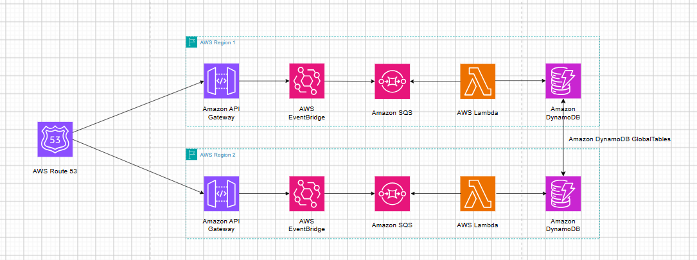

# Multi-Region Order Processing Architecture on AWS: Redirecting New Requests to a Secondary Region During a Primary Region Failure

An e-commerce platform may receive thousands of order requests throughout the day. When a customer clicks the **Place Order** button, the system must receive the request, record the relevant information, send an event into the processing workflow, and store the processing result. If the entire application operates in only one AWS Region, a major failure in that Region could prevent customers from submitting new orders and disrupt the processing of events that are already waiting in the system.

One way to reduce this risk is to prepare an additional AWS Region for disaster recovery. However, deploying extra resources in a second Region is not sufficient on its own. The system must also detect when the primary Region becomes unavailable, redirect new requests to the secondary Region, continue processing events, and ensure that the necessary data remains accessible in the alternative Region.

To address this challenge, the **Multi-Region Event-Driven Failover** architecture combines Amazon Route 53, Amazon API Gateway, Amazon EventBridge, Amazon SQS, AWS Lambda, and Amazon DynamoDB Global Tables. The architecture follows an **Active-Passive** model: the primary Region handles normal traffic, while the secondary Region is prepared to receive requests when the primary Region's API endpoint no longer passes its health checks.

The online store scenario in this article is hypothetical and is used only to illustrate how the architecture works. It does not describe an actual customer case or a specific e-commerce system that has been deployed.

## 1. THE PROBLEM: WHAT HAPPENS WHEN THE PRIMARY REGION FAILS?

### 1.1. Risks of Deploying an Application in Only One Region

An AWS Region is a separate geographical area within the AWS infrastructure. A Region can contain multiple Availability Zones (AZs), allowing applications to improve fault tolerance within that geographical area. However, if an entire application is deployed in only one Region, a major incident affecting that Region can still cause a large-scale service disruption.

For example, an online store receives customer orders through an API. When a customer submits an order, the system must record the event, send it into the processing workflow, and update the order data. If the API endpoint in the active Region becomes unavailable, new requests may no longer be accepted. Event-processing components that depend on that Region may also be affected.

In this situation, the business needs to do more than restore the application's user interface. The system must also determine which requests have already been accepted, which messages are still waiting to be processed, which data has been recorded, and how to resume customer service without creating duplicate orders or inconsistent transaction states.

### 1.2. Key Challenges to Address

Deploying an additional Region is meaningful only when the secondary Region can replace the primary Region for the required business operations. To achieve this, the system must address three closely related challenges:

1. **Failure detection:** Determine whether the endpoint in the primary Region is still healthy and able to serve requests.
2. **Request routing:** Redirect new DNS queries to the secondary Region's endpoint when the primary endpoint becomes unhealthy.
3. **Processing and data continuity:** Prepare an event-processing pipeline in the secondary Region and maintain data replicas so that the alternative Region can continue operating.

Multi-AZ and Multi-Region architectures should also be distinguished. Multi-AZ focuses on fault tolerance across Availability Zones within the same Region. Multi-Region extends the recovery strategy to another AWS geographical area, but usually requires greater operational effort and higher infrastructure costs.

## 2. OVERVIEW OF THE PROPOSED ARCHITECTURE

### 2.1. Overall Architecture

The solution uses two AWS Regions in an Active-Passive configuration. Under normal conditions, the Primary Region receives and processes application traffic. The Secondary Region is preconfigured with the components required to accept requests when a failover occurs.

Each Region has its own event-processing pipeline:

**Amazon API Gateway → Amazon EventBridge → Amazon SQS → AWS Lambda → Amazon DynamoDB**

Amazon Route 53 manages the shared domain name and the Primary/Secondary DNS records. A Health Check monitors the API Gateway endpoint in the primary Region. Amazon DynamoDB Global Tables maintain data replicas between the two Regions.

**Architecture Diagram:**

*Figure 1. Multi-Region event-processing architecture using the Active-Passive model. Image source: AWS Compute Blog – “Multi-Region event-driven failover architecture with Amazon EventBridge and Route 53” (June 1, 2026).*

The diagram can be understood through three main functional groups:

1. **Traffic routing:** Route 53 resolves the shared domain name to the endpoint of the selected Region.
2. **Event ingestion and processing:** API Gateway receives requests; EventBridge routes events; SQS stores messages; and Lambda processes them.
3. **Data storage and replication:** Lambda writes data to DynamoDB in the active Region, while Global Tables replicate changes to the replica in the other Region.

The two processing pipelines are deployed independently in their respective Regions. The EventBridge buses, SQS queues, and Lambda functions in the Secondary Region are separate resources; they are not shared queues or Lambda functions operating across Regions. The Lambda Event Source Mapping and the SQS queue it reads from must be located in the same AWS Region.

If the same custom domain name is used for API Gateway in both Regions, the custom domain must be configured separately in each Region, with an appropriate SSL/TLS certificate in AWS Certificate Manager for each Region. In the illustrative configuration, the Health Check monitors the API Gateway endpoint using the Region-specific `execute-api` domain, with the `/Prod/health` path and HTTPS port 443.

### 2.2. Distinguishing DNS Routing from Event Processing

This architecture contains two separate operational flows:

- **Routing flow:** A user accesses the shared domain name. Route 53 responds to the DNS query with either the Primary or Secondary record, depending on the Health Check status and the Failover Routing Policy.
- **Event-processing flow:** After a request reaches API Gateway in a particular Region, API Gateway sends the event to that Region's EventBridge bus. EventBridge routes the matching event to SQS, and Lambda reads the message and writes data to the corresponding DynamoDB replica.

Route 53 does not directly forward individual HTTP packets or migrate an existing connection from one Region to another. It participates in the DNS resolution process. After receiving the DNS response, the browser or application establishes a connection to the returned endpoint. Therefore, DNS Failover does not automatically transfer existing connections to the secondary Region.

## 3. WHEN THE SYSTEM OPERATES NORMALLY

### 3.1. A Customer Submits an Order

When a customer clicks **Place Order**, the application sends an HTTP request to the system's shared domain name. Under normal conditions, Route 53 resolves the domain name to the API Gateway endpoint in the Primary Region.

API Gateway receives the request data, such as the order ID, customer ID, and product information. API Gateway then uses an AWS service integration to send an event to EventBridge through the `PutEvents` API. In this example, `OrderCreated` is an assumed event type defined by the application to represent a new order request.

It is important to distinguish **event acceptance** from **order processing completion**. When API Gateway successfully sends an event to EventBridge, this does not mean that Lambda has finished processing the order or that the entire ordering workflow has been completed. This is an asynchronous process: the event is accepted first, and the downstream processing steps take place afterward.

One important detail is checking the response from `PutEvents`. An HTTP 200 response does not guarantee that every entry in the request was successfully accepted. When multiple entries are submitted, EventBridge may accept some entries while returning errors for others. The application must check `FailedEntryCount` and the error information for each entry to identify events that need to be retried.

In addition, if the target Event Bus does not exist, EventBridge may still return HTTP 200 while the event is dropped without being counted in `FailedEntryCount`. Therefore, the Event Bus name and its existence must also be properly managed and validated.

Once the system confirms that an event has been accepted, the user interface should display a status such as "Your order request has been received." The message "Order placed successfully" should be displayed only after the necessary business conditions have been verified.

### 3.2. Events Are Delivered to a Queue

After EventBridge receives an event, it evaluates the Event Rules configured on the Event Bus. A rule identifies the event types or data patterns that need to match. When an event satisfies the rule's conditions, EventBridge sends it to the corresponding target. In this architecture, the target is an SQS queue in the same Region.

For example, an `OrderCreated` event may match a rule designed for new order requests. EventBridge then forwards the event to the queue, where it waits to be processed.

SQS acts as a buffer between the time a request is received and the time its business logic is executed. If many customers place orders within a short period, messages can be stored in the queue rather than forcing the API to wait for Lambda to process each request individually.

This separates the rate at which requests are accepted from the rate at which they are processed. However, it does not mean that every message will be processed immediately or successfully on the first attempt.

### 3.3. Lambda Processes Messages and Writes Data

Lambda is configured to read messages from SQS through an Event Source Mapping. Lambda polls the queue, receives messages in batches, and executes the processing function.

When the entire batch is processed successfully, the corresponding messages are deleted from the queue. If the function fails, the messages in the batch may become visible again after the Visibility Timeout expires and can be processed again.

In the order-processing example, Lambda may validate product information, verify the required input data, record the order, and update its processing status in DynamoDB in the Primary Region. The exact business operations depend on the application's design; this architecture focuses on the overall flow of request ingestion, message queuing, processing, and data storage.

Because SQS and Lambda operate using **at-least-once delivery**, a message may be processed more than once. Therefore, the application must implement **Idempotency** so that processing the same request repeatedly does not create unintended business effects.

For an order-processing system, a stable business-level Idempotency Key should be used. For example, the application can generate a request ID and keep it unchanged across retries. The system can use this key to determine whether the request has already been processed before creating another order. The key must be stored and checked consistently; relying only on the EventBridge event ID is not sufficient for every scenario.

Two types of identifiers should be distinguished:

- **EventBridge event ID:** EventBridge assigns an ID when it receives an event through `PutEvents`. If the same SQS message is delivered again, the EventBridge event ID contained in that message remains unchanged. Therefore, it can help identify repeated processing of that particular event.
- **Order Idempotency Key:** This key is generated by the application and remains unchanged when the same business request is submitted again. If a customer retries the request and the system calls `PutEvents` again, EventBridge may assign a new event ID. A stable business-level key is needed to recognize that both events represent the same order request.

### 3.4. Data Is Replicated to the Secondary Region

After Lambda writes data to DynamoDB in the Primary Region, DynamoDB Global Tables automatically replicate the changes to the configured table replicas in other Regions. This allows the application in the Secondary Region to access a local copy of the data when it needs to receive traffic.

In the illustrative configuration, the Global Table is created with replicas in two Regions without specifying a different consistency mode. When no alternative mode is specified, DynamoDB Global Tables use **Multi-Region Eventual Consistency (MREC)** by default.

With MREC, changes are replicated asynchronously. Replication often takes approximately one second or less, but this is not a guaranteed fixed interval. Actual replication latency depends on the Regions involved, workload, and other operational factors.

It is also important to distinguish the Active-Passive model at the application layer from the multi-active capabilities of DynamoDB Global Tables. The application architecture prioritizes traffic processing in the Primary Region, but Global Tables replicas can still accept read and write operations.

During a failover, DNS caching may cause some users to continue accessing the Primary Region while others have already been redirected to the Secondary Region. If both Regions update the same data item while replication is in progress, write conflicts may occur. With MREC, DynamoDB resolves conflicts at the item level using a **last writer wins** mechanism based on the internal timestamp of the write.

## 4. HOW DOES THE SYSTEM FAIL OVER WHEN THE PRIMARY REGION FAILS?

Consider the online store scenario again. During a peak period, the API Gateway endpoint in the Primary Region stops responding according to the configured Health Check conditions. Without a backup mechanism, users may continue sending requests to the failed endpoint.

### 4.1. Route 53 Detects an Unhealthy Endpoint

Route 53 uses a Health Check to send monitoring requests to the API Gateway endpoint in the Primary Region. The illustrative configuration uses HTTPS, the `/Prod/health` path, port 443, a 30-second check interval, and a Failure Threshold of 3.

For HTTP/HTTPS Health Checks, each health checker must establish a TCP connection to the endpoint within the specified time and receive an HTTP 2xx or 3xx response within the permitted response time. Route 53 uses health checkers in multiple locations and aggregates their results to evaluate the endpoint's health.

An HTTPS Health Check does not validate whether the SSL/TLS certificate is valid or whether it has expired.

When the endpoint fails the required number of consecutive checks, Route 53 may mark the Primary record as unhealthy. Under the Failover Routing Policy, new DNS queries can then receive the Secondary record if the backup record meets the configured conditions.

The timing must be understood correctly. A 30-second interval and a threshold of 3 correspond to approximately 90 seconds under a simplified calculation. However, this does not guarantee that the entire application will recover in exactly 90 seconds.

Health status evaluation involves multiple health checkers. After that, DNS TTL, resolver caching, and the readiness of the Secondary Region also affect the overall recovery time. In the illustrative test scenario, the suggested waiting period is approximately 2–3 minutes.

A Health Check also reflects only the endpoint and conditions it has been configured to monitor. For example, if `/Prod/health` returns a successful status whenever API Gateway responds, without checking important downstream dependencies, Route 53 may still consider the endpoint healthy even if EventBridge, SQS, Lambda, or DynamoDB is experiencing problems.

Therefore, the health-check endpoint must be designed according to the level of application availability that the system intends to evaluate.

### 4.2. New Requests Are Redirected to the Secondary Region

When the Primary record is marked unhealthy, Route 53 can return the Secondary record for new DNS queries. The application resolves the shared domain name again and receives the API Gateway endpoint in the Secondary Region.

New order requests are then processed through the secondary Region's own pipeline:

1. API Gateway in the Secondary Region receives the HTTP request.
2. API Gateway sends the event to the Secondary Region's EventBridge bus through `PutEvents`.
3. EventBridge evaluates its rules and forwards matching events to the Region's SQS queue.
4. Lambda in the Secondary Region reads the messages and performs the processing operations.
5. Lambda writes the data to the DynamoDB replica in the Secondary Region.
6. DynamoDB Global Tables replicate the changes to the other configured replicas according to the selected consistency mode.

Because the Secondary Region has its own processing pipeline and access to replicated data, it can continue receiving and processing new requests that are redirected to it. This is the central purpose of the failover mechanism in this architecture.

However, DNS caching means that the transition may not happen simultaneously for all users. Some applications may continue sending requests to the old endpoint while the previous DNS result remains cached. Therefore, the application needs timeouts, controlled retries, and a stable business-level Idempotency Key.

### 4.3. What Happens to Requests Submitted Before the Failure?

Each Region has its own SQS queue. In this architecture, the SQS queue in the Primary Region is not automatically replicated to the SQS queue in the Secondary Region.

Therefore, if a request has already been accepted and is waiting to be processed in the Primary Region's SQS queue immediately before the failure, the message cannot be assumed to appear automatically in the Secondary Region's queue.

The original queue remains associated with its initial Region. Whether its messages can still be accessed and processed depends on the operational status of that Region.

For a real-world order-processing system, the business needs a method to reconcile requests that have been accepted but have not yet received a final result. One possible approach is to use an order ID or Idempotency Key to verify the request status, allow customers to retry safely, and prevent duplicate orders.

This is an additional business-level design requirement. It is not an automatic capability guaranteed by DNS Failover alone.

### 4.4. Why Might Users Still Experience Errors During the Transition?

Route 53 changes DNS responses; it does not directly migrate individual network connections. A DNS resolver, browser, or application may continue using the cached IP address or endpoint of the Primary Region until the TTL or cache expiration time is reached.

Existing connections to the old endpoint are also not automatically transferred to the Secondary Region.

As a result, some requests may still reach the old endpoint and fail during the transition. The application should implement timeout handling, DNS re-resolution, and controlled retries.

The Idempotency Key must remain unchanged across retry attempts to prevent the same order request from being recorded multiple times.

## 5. WHAT HAPPENS WHEN THE PRIMARY REGION RECOVERS?

When the endpoint in the Primary Region becomes operational again and passes the Health Check conditions, Route 53 may mark the Primary record as healthy and prioritize it again under the Failover Routing Policy.

In the illustrative configuration, after the endpoint is restored, traffic is routed back to the Primary Region after approximately 2–3 minutes. This is an observed result from the example configuration, not a guaranteed recovery time for every system.

Failback does not necessarily occur simultaneously for all users. Some DNS resolvers may continue using previously cached results until their TTL or cache expiration time is reached. As a result, some requests may still reach the Secondary Region even after the Primary Region has recovered.

While the Secondary Region is processing requests, changes written to DynamoDB Global Tables are replicated to the other replicas according to the configured consistency mode. With MREC, replication is asynchronous.

If a Region is temporarily isolated, changes that have not yet been replicated are retried when the replica becomes available again. However, newly written data that has not yet been replicated may not be available for applications in the other Region to read during the incident.

In addition to checking data replication, the business must also review messages that remain in the Primary Region's SQS queue before declaring that the system has returned to normal operation.

Restoring the endpoint does not automatically mean that all pending messages, data, and business processes have been fully reconciled.

## 6. BENEFITS AND LIMITATIONS TO CONSIDER

### 6.1. Problems Addressed by the Architecture

- **Reduced dependency on a single Region:** When the primary endpoint becomes unhealthy, Route 53 can redirect new DNS queries to the Secondary Region, providing an alternative request-ingestion path.
- **A dedicated processing pipeline in the Secondary Region:** The Secondary Region has its own API Gateway, EventBridge, SQS, and Lambda resources to process newly redirected events.
- **Separation of request ingestion and processing:** EventBridge routes events according to configured rules, while SQS stores messages for Lambda to process later. This separates request acceptance from downstream business processing.
- **Cross-Region data replication:** DynamoDB Global Tables replicate data across configured Regions, helping applications access data from the backup Region when a failover is required.

### 6.2. Limitations and Risks That Must Be Understood

**DNS Failover is not instantaneous:** Health Checks need time to detect failures. DNS TTL and caching may also cause users to continue using the old endpoint. Existing connections are not automatically transferred to another Region.

**Health Checks do not automatically validate the entire business workflow:** If the health-check endpoint does not verify important dependencies, the system may still be considered healthy even when a downstream component has failed. The Health Check must be designed according to the application's operational requirements.

**Queues are not automatically transferred between Regions:** The SQS queues in the Primary and Secondary Regions are separate. Messages waiting in the Primary Region are not automatically replicated to the Secondary Region in this architecture.

**Messages may be processed more than once:** Lambda integrates with SQS using at-least-once delivery. The application must implement idempotent processing based on a stable business-level key rather than relying only on the EventBridge event ID.

**Data replication may be delayed:** MREC replicates data asynchronously. If a failure occurs immediately after a write, the replica in the other Region may not yet contain the latest change. If the same item is updated in multiple Regions, the last writer wins mechanism may determine which version is retained.

**Higher operational complexity and cost:** The business must maintain resources in multiple Regions, monitor Health Checks, manage configurations and IAM permissions, monitor replication latency, test failover and failback procedures, and account for cross-Region data transfer costs.

### 6.3. RTO and RPO: Two Objectives to Define in Advance

When designing a Disaster Recovery strategy, a business must define two important objectives:

- **Recovery Time Objective (RTO):** The maximum acceptable period of service disruption before the system must be restored.
- **Recovery Point Objective (RPO):** The maximum acceptable amount of data loss, commonly expressed as the time period of data that may be lost.

The approximately 90-second Health Check timing in the illustrative configuration cannot be treated as the RTO for the entire system. Actual RTO also depends on failure detection, DNS caching, the readiness of the Secondary Region, retrying failed requests, queue status, and the availability of application dependencies.

With MREC, data replication is asynchronous, so the RPO depends on replication latency at the time of the failure. It is not accurate to claim that the RPO is zero simply because the system uses DynamoDB Global Tables.

DynamoDB also supports **Multi-Region Strong Consistency (MRSC)**. This mode provides strong consistency across Regions and an RPO of zero under the Global Tables model. However, it must be designed when the table is initially created.

MRSC requires exactly three Regions: either three replicas or two replicas and one witness. This mode has higher write latency because it requires cross-Region communication, and an existing Global Table cannot be converted from MREC to MRSC.

Therefore, MRSC is not an option that can simply be substituted into the two-Region architecture discussed in this article.

### 6.4. Automatic or Manual Failover?

The architecture uses Health Checks and Route 53 to automatically redirect DNS queries when the primary endpoint is considered unhealthy. This approach can reduce the need for manual intervention by the operations team.

However, automatic failover based on Health Checks or alerts must be considered carefully. An incorrect health assessment may trigger an unnecessary Region switch, causing service disruption or introducing data-related risks.

The AWS Well-Architected Framework notes that, in some situations, organizations may choose to trigger failover manually while automating the recovery steps themselves. This allows the operations team to maintain control over the decision while still executing the recovery process quickly and consistently.

Therefore, the choice between automatic and manual failover should be based on the required RTO, data criticality, failure-detection capabilities, and the reliability of the Health Check mechanism.

### 6.5. When Is This Architecture Suitable?

The Multi-Region Event-Driven Failover architecture is worth considering for applications that:

- Must maintain the ability to receive requests when an AWS Region fails.
- Have event-processing workflows that can be separated into request ingestion, routing, queuing, and background processing stages.
- Can use an Active-Passive model and accept the characteristics of DNS Failover, data replication latency, and recovery time.
- Have sufficient resources to operate, monitor, test, and pay for infrastructure in multiple Regions.

In contrast, if an application only requires fault tolerance within an Availability Zone or a single Region and has no clearly defined cross-Region recovery requirement, the business should evaluate a Multi-AZ solution before investing in a Multi-Region architecture.

The choice of architecture should be based on business requirements rather than simply on the number of AWS services that can be combined.

## 7. CONCLUSION

The Multi-Region Event-Driven Failover architecture combines Amazon Route 53, Amazon API Gateway, Amazon EventBridge, Amazon SQS, AWS Lambda, and Amazon DynamoDB Global Tables to help an application continue receiving and processing events when the endpoint in its primary Region fails.

In the online store scenario, Route 53 redirects new DNS queries to the Secondary Region. API Gateway receives requests, EventBridge routes events, SQS stores messages for processing, Lambda executes the business logic, and DynamoDB Global Tables replicate data across Regions.

Each component has a specific responsibility, and together they support service continuity during a failure.

However, deploying an additional Region does not automatically guarantee uninterrupted service or zero data loss. DNS Failover involves delays; Health Checks reflect only the endpoints and conditions being monitored; SQS queues in different Regions are independent; Lambda may process messages more than once; and DynamoDB Global Tables using MREC have replication latency and potential write conflicts that must be considered.

Before adopting this architecture, a business should define its RTO and RPO, design appropriate Health Checks, implement stable business-level Idempotency Keys, establish a reconciliation process for incomplete messages, and regularly test failover and failback scenarios.

Disaster recovery does not depend solely on having an additional Region. It also depends on how the system manages requests, data, and business states throughout the entire transition process.

## REFERENCES

- AWS Compute Blog – *Multi-Region event-driven failover architecture with Amazon EventBridge and Route 53* (June 1, 2026):  
  https://aws.amazon.com/blogs/compute/multi-region-event-driven-failover-architecture-with-amazon-eventbridge-and-route-53/

- Amazon Route 53 – *Failover routing*:  
  https://docs.aws.amazon.com/Route53/latest/DeveloperGuide/routing-policy-failover.html

- Amazon Route 53 – *How Amazon Route 53 determines whether a health check is healthy*:  
  https://docs.aws.amazon.com/Route53/latest/DeveloperGuide/dns-failover-determining-health-of-endpoints.html

- Amazon EventBridge – *Rules in Amazon EventBridge*:  
  https://docs.aws.amazon.com/eventbridge/latest/userguide/eb-rules.html

- Amazon EventBridge – *Sending events with PutEvents*:  
  https://docs.aws.amazon.com/eventbridge/latest/userguide/eb-putevents.html

- AWS Lambda – *Using Lambda with Amazon SQS*:  
  https://docs.aws.amazon.com/lambda/latest/dg/with-sqs.html

- Amazon DynamoDB – *Global tables – multi-active, multi-Region replication*:  
  https://docs.aws.amazon.com/amazondynamodb/latest/developerguide/GlobalTables.html

- Amazon DynamoDB – *Using DynamoDB global tables*:  
  https://docs.aws.amazon.com/amazondynamodb/latest/developerguide/bp-global-table-design.html

- AWS Well-Architected Framework – *Use defined recovery strategies to meet the recovery objectives*:  
  https://docs.aws.amazon.com/wellarchitected/latest/framework/rel_planning_for_recovery_disaster_recovery.html