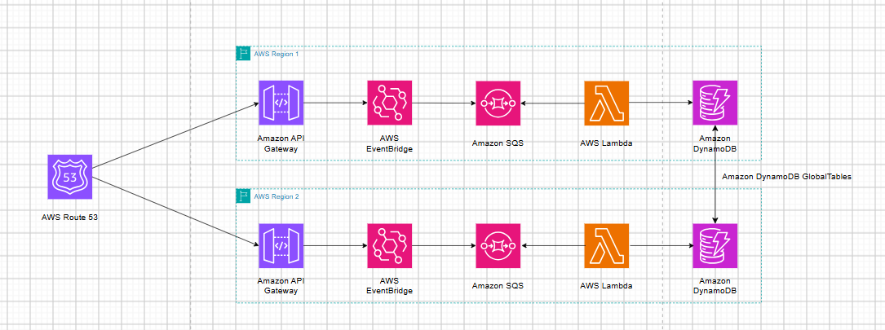

# Thiết kế hệ thống xử lý sự kiện đa Region có khả năng phục hồi cao trên AWS với Amazon EventBridge và Amazon Route 53

Khi một ứng dụng chỉ được triển khai tại một AWS Region, sự cố nghiêm trọng tại khu vực đó có thể làm gián đoạn toàn bộ dịch vụ. Điều này đặc biệt ảnh hưởng đến các hệ thống xử lý sự kiện như tiếp nhận đơn hàng, cập nhật giao dịch hoặc ghi nhận hoạt động người dùng, nơi yêu cầu về tính sẵn sàng và khả năng duy trì dữ liệu rất quan trọng.

Để hạn chế rủi ro, doanh nghiệp có thể triển khai kiến trúc Multi-Region, trong đó một Region đảm nhiệm vai trò chính và một Region khác được chuẩn bị làm môi trường dự phòng. Bằng cách kết hợp Amazon Route 53, Amazon API Gateway, Amazon EventBridge, Amazon SQS, AWS Lambda và Amazon DynamoDB Global Tables, hệ thống có thể chuyển hướng các yêu cầu mới sang Region dự phòng khi Region chính gặp sự cố.

## CÁC ĐIỂM CHÍNH CẦN NẮM

- **Multi-Region Architecture:** Triển khai ứng dụng tại nhiều AWS Region để tăng khả năng sẵn sàng và hỗ trợ khôi phục sau sự cố.
- **Active-Passive:** Sử dụng Primary Region để xử lý lưu lượng bình thường và Secondary Region làm môi trường dự phòng.
- **Amazon Route 53:** Sử dụng Health Check và Failover Routing Policy để kiểm tra endpoint và định tuyến DNS đến Region phù hợp.
- **Event-Driven Processing:** API Gateway tiếp nhận yêu cầu, EventBridge định tuyến sự kiện, SQS lưu thông điệp và Lambda thực hiện xử lý.
- **DynamoDB Global Tables:** Duy trì các bản sao dữ liệu tại nhiều Region thông qua cơ chế nhân bản liên vùng.
- **Automatic Failover:** Khi Primary Region không đáp ứng điều kiện Health Check, Route 53 có thể chuyển các truy vấn DNS mới sang Secondary Region.
- **Data Consistency:** Cần quan tâm đến độ trễ nhân bản, xử lý xung đột dữ liệu và khả năng xử lý thông điệp trùng lặp.

## 1. TỔNG QUAN VỀ KIẾN TRÚC

**Multi-Region Architecture** là mô hình triển khai ứng dụng trên nhiều AWS Region nhằm giảm sự phụ thuộc vào một khu vực hạ tầng duy nhất. Trong bài viết này, giải pháp sử dụng mô hình Active-Passive gồm:

- **Primary Region:** Khu vực chính, tiếp nhận và xử lý các yêu cầu trong điều kiện hoạt động bình thường.
- **Secondary Region:** Khu vực dự phòng, được triển khai sẵn các thành phần cần thiết để tiếp nhận yêu cầu khi Primary Region gặp sự cố.

Bên cạnh đó, hệ thống sử dụng **Event-Driven Architecture (EDA)**, cho phép các thành phần giao tiếp thông qua sự kiện thay vì phụ thuộc trực tiếp vào nhau. Cách tiếp cận này giúp tách biệt quá trình tiếp nhận, định tuyến và xử lý dữ liệu, đồng thời hỗ trợ mở rộng từng thành phần độc lập.

## 2. CÁC DỊCH VỤ AWS VÀ VAI TRÒ

| Dịch vụ | Vai trò |
|---|---|
| Amazon Route 53 | Quản lý DNS, kiểm tra tình trạng endpoint và thực hiện Failover Routing. |
| Amazon API Gateway | Tiếp nhận yêu cầu HTTP/HTTPS và chuyển sự kiện đến EventBridge. |
| Amazon EventBridge | Tiếp nhận sự kiện qua Event Bus và định tuyến theo Event Rules. |
| Amazon SQS | Lưu giữ thông điệp trong hàng đợi để chờ xử lý. |
| AWS Lambda | Lấy thông điệp từ SQS, xử lý nghiệp vụ và ghi dữ liệu vào DynamoDB. |
| Amazon DynamoDB Global Tables | Nhân bản dữ liệu giữa các AWS Region. |

**Amazon Route 53 – DNS Failover**

Route 53 sử dụng Health Check để kiểm tra tình trạng hoạt động của endpoint tại Primary Region. Khi endpoint không còn đáp ứng điều kiện kiểm tra, Failover Routing Policy cho phép Route 53 trả về địa chỉ của Secondary Region cho các truy vấn DNS mới.

**Amazon API Gateway và Amazon EventBridge**

API Gateway là điểm tiếp nhận yêu cầu từ ứng dụng. Thông qua AWS Service Integration và API `PutEvents`, API Gateway chuyển dữ liệu sự kiện đến EventBridge. EventBridge tiếp nhận sự kiện, đánh giá các Event Rules và chuyển những sự kiện phù hợp đến Target được cấu hình.

**Amazon SQS và AWS Lambda**

SQS đóng vai trò hàng đợi trung gian, giúp tách biệt quá trình tiếp nhận sự kiện với quá trình xử lý. Lambda sử dụng Event Source Mapping để lấy thông điệp từ SQS theo từng batch và thực hiện logic nghiệp vụ.

**Amazon DynamoDB Global Tables**

Global Tables duy trì các bản sao của cùng một bảng DynamoDB tại nhiều Region. Khi dữ liệu được ghi vào một Replica, các thay đổi sẽ được nhân bản đến những Replica còn lại theo chế độ nhất quán đã cấu hình.

## 3. KIẾN TRÚC VÀ LUỒNG XỬ LÝ HOẠT ĐỘNG

### 3.1. Kiến trúc tổng thể

Giải pháp triển khai hai pipeline xử lý sự kiện độc lập tại hai AWS Region. Mỗi Region có các thành phần API Gateway, EventBridge, SQS và Lambda. Route 53 quản lý định tuyến DNS, trong khi DynamoDB Global Tables đảm nhiệm việc nhân bản dữ liệu giữa hai khu vực.

**Sơ đồ kiến trúc:**



*Hình 1. Kiến trúc chuyển đổi dự phòng đa Region sử dụng Amazon Route 53 và các dịch vụ AWS Serverless.*

Luồng xử lý chính tại mỗi Region:

`Amazon API Gateway → Amazon EventBridge → Amazon SQS → AWS Lambda → Amazon DynamoDB`

### 3.2. Khi hệ thống hoạt động bình thường

Khi Primary Region hoạt động ổn định, Route 53 phân giải tên miền và ưu tiên trả về endpoint của Region chính.

Luồng xử lý:

1. Người dùng gửi yêu cầu đến tên miền ứng dụng và được Route 53 phân giải đến Primary Region.
2. API Gateway tiếp nhận yêu cầu và gửi sự kiện đến EventBridge thông qua API `PutEvents`.
3. EventBridge đánh giá Event Rules và chuyển sự kiện phù hợp đến SQS.
4. Lambda lấy thông điệp từ SQS theo từng batch thông qua Event Source Mapping.
5. Lambda xử lý sự kiện và ghi kết quả vào DynamoDB Replica tại Primary Region.
6. DynamoDB Global Tables nhân bản thay đổi dữ liệu sang Replica tại Secondary Region.

### 3.3. Khi Primary Region gặp sự cố

Khi Primary Region không còn đáp ứng điều kiện Health Check, Route 53 cập nhật trạng thái và áp dụng Failover Routing Policy.

Luồng xử lý:

1. Route 53 Health Check phát hiện endpoint của Primary Region không còn khỏe mạnh.
2. Route 53 chuyển sang sử dụng Secondary Record cho các truy vấn DNS mới.
3. Người dùng được định tuyến đến API Gateway tại Secondary Region.
4. EventBridge tiếp nhận và định tuyến sự kiện đến SQS của Region dự phòng.
5. Lambda tại Secondary Region xử lý thông điệp và ghi dữ liệu vào DynamoDB Replica cục bộ.

Nhờ các thành phần đã được triển khai sẵn, Secondary Region có thể tiếp tục tiếp nhận và xử lý các yêu cầu mới mà không cần xây dựng lại toàn bộ hệ thống.

### 3.4. Khi Primary Region phục hồi

Khi endpoint của Primary Region hoạt động ổn định trở lại và vượt qua Health Check, Route 53 có thể tiếp tục ưu tiên Primary Record cho những truy vấn DNS mới.

Quá trình đưa lưu lượng trở về Region chính được gọi là **Failback**. Tuy nhiên, người dùng có thể vẫn sử dụng kết quả DNS cũ trong một khoảng thời gian do DNS cache và TTL. Vì vậy, quá trình chuyển đổi không nhất thiết diễn ra đồng thời trên tất cả thiết bị.

## 4. CƠ CHẾ NHÂN BẢN DỮ LIỆU VỚI DYNAMODB GLOBAL TABLES

DynamoDB Global Tables giúp duy trì dữ liệu tại nhiều Region, cho phép ứng dụng truy cập bản sao cục bộ khi một Region khác gặp sự cố.

Hiện nay, Global Tables hỗ trợ hai chế độ nhất quán chính:

- **Multi-Region Eventual Consistency (MREC):** Chế độ mặc định nếu không chỉ định chế độ khác. Dữ liệu được nhân bản bất đồng bộ giữa các Region và có thể tồn tại độ trễ trước khi mọi Replica nhận được thay đổi.
- **Multi-Region Strong Consistency (MRSC):** Cung cấp khả năng nhất quán mạnh giữa các Region theo những điều kiện và giới hạn triển khai của AWS.

Trong mẫu kiến trúc của bài AWS gốc, cấu hình CloudFormation tạo các Replica nhưng không chỉ định chế độ nhất quán khác. Vì vậy, cấu hình mặc định được áp dụng là MREC.

Một số vấn đề cần quan tâm:

- **Replication Lag:** Độ trễ giữa thời điểm dữ liệu được ghi và thời điểm xuất hiện tại Replica khác.
- **Write Conflict:** Xung đột khi cùng một bản ghi được cập nhật đồng thời tại nhiều Region.
- **Data Consistency:** Dữ liệu tại các Region có thể tạm thời khác nhau trong thời gian nhân bản chưa hoàn tất.
- **Recovery Point Objective (RPO):** Cần đánh giá mức độ mất dữ liệu có thể chấp nhận khi xảy ra sự cố.

Do đó, không nên mặc định rằng mọi dữ liệu vừa ghi tại Primary Region đã được đồng bộ ngay lập tức sang Secondary Region.

## 5. TRIỂN KHAI VÀ KIỂM THỬ FAILOVER

Để triển khai giải pháp theo hướng dẫn AWS, cần chuẩn bị:

- Tài khoản AWS có quyền quản lý các dịch vụ liên quan.
- AWS CLI và AWS SAM CLI đã được cài đặt, cấu hình.
- Tên miền đã đăng ký và Hosted Zone trên Route 53.
- Chứng chỉ ACM phù hợp tại cả hai Region nếu sử dụng Regional Custom Domain.
- Hai AWS Region được lựa chọn làm Primary và Secondary.

**Quy trình triển khai tổng quát:**

1. **Deploy Primary Stack:** Tạo API Gateway, EventBridge, SQS, Lambda, Route 53 Health Check, Primary DNS Record và DynamoDB Global Table với các Replica cần thiết.
2. **Deploy Secondary Stack:** Tạo pipeline xử lý riêng tại Region dự phòng và tham chiếu đến DynamoDB Global Table đã được tạo.
3. **Kiểm tra hoạt động:** Gửi một sự kiện đến Custom Domain và xác nhận yêu cầu được tiếp nhận tại Primary Region.
4. **Mô phỏng sự cố:** Làm cho Primary API Gateway Endpoint không còn đáp ứng Health Check trong môi trường thử nghiệm.
5. **Xác nhận Failover:** Gửi lại yêu cầu và kiểm tra hệ thống đã chuyển sang Secondary Region.
6. **Kiểm tra dữ liệu:** Xem CloudWatch Logs của Lambda và xác nhận bản ghi đã được lưu tại DynamoDB Replica của Secondary Region.
7. **Khôi phục Primary:** Khôi phục API Gateway Stage và Base Path Mapping, sau đó xác nhận Route 53 có thể ưu tiên lại Primary Region.

**Ví dụ gửi sự kiện kiểm thử:**

```bash
curl -X POST https://api.example.com \
  -H "Content-Type: application/json" \
  -d '{
    "Detail": {
      "IsHelloWorldExample": "true"
    },
    "DetailType": "POSTED",
    "Source": "demo.event"
  }' -v
```

Theo mẫu AWS, phản hồi HTTP có header `X-Region` để nhận biết Region đang tiếp nhận yêu cầu. Khi hoạt động bình thường, kết quả thể hiện Primary Region; sau khi Failover thành công, kết quả thể hiện Secondary Region.

**Lưu ý:** Với cấu hình Health Check mẫu có chu kỳ 30 giây và Failure Threshold bằng 3, thời gian phát hiện lỗi theo ngưỡng là khoảng 90 giây. Tuy nhiên, thời gian chuyển đổi thực tế còn phụ thuộc vào DNS TTL và bộ nhớ cache của DNS Resolver.

## 6. LỢI ÍCH VÀ NHỮNG LƯU Ý KHI SỬ DỤNG

**Lợi ích:**

- **Tăng tính sẵn sàng:** Giảm sự phụ thuộc vào một AWS Region duy nhất.
- **Hỗ trợ khôi phục:** Có sẵn môi trường dự phòng khi Region chính gặp sự cố.
- **Giảm sự phụ thuộc giữa các thành phần:** EventBridge và SQS hỗ trợ tách biệt quá trình tiếp nhận và xử lý sự kiện.
- **Duy trì dữ liệu đa khu vực:** DynamoDB Global Tables nhân bản dữ liệu giữa các Region.
- **Dễ quản lý hạ tầng:** AWS SAM và CloudFormation hỗ trợ triển khai tài nguyên thông qua Infrastructure as Code.

**Những lưu ý quan trọng:**

- **DNS Failover không phải chuyển đổi tức thời:** Các DNS Resolver có thể tiếp tục sử dụng kết quả phân giải cũ cho đến khi TTL hết hạn.
- **Health Check phải phù hợp:** Endpoint kiểm tra cần phản ánh tình trạng phục vụ thực tế của ứng dụng.
- **Xử lý thông điệp trùng lặp:** Lambda và SQS có thể xử lý một thông điệp nhiều lần; cần thiết kế logic Idempotent và cân nhắc Dead-Letter Queue.
- **Theo dõi nhân bản dữ liệu:** Cần giám sát ReplicationLatency đối với Global Tables sử dụng MREC.
- **Kiểm soát quyền IAM:** Cấp quyền theo nguyên tắc Least Privilege.
- **Theo dõi chi phí:** Cần tính đến API Gateway, Route 53 Health Checks, DynamoDB Global Tables, Lambda, SQS, CloudWatch Logs và dữ liệu truyền giữa các Region.

Sau khi hoàn thành thử nghiệm, nên xóa Secondary Stack trước rồi mới xóa Primary Stack theo hướng dẫn triển khai của AWS. Đặc biệt, cần sao lưu dữ liệu quan trọng vì quá trình xóa Primary Stack có thể xóa Global Table và dữ liệu đã lưu.

## 7. KẾT LUẬN

Kiến trúc Multi-Region Event-Driven Failover kết hợp Amazon EventBridge và Amazon Route 53 là giải pháp hỗ trợ cải thiện khả năng sẵn sàng và khôi phục cho các ứng dụng xử lý sự kiện trên AWS.

Trong mô hình này, Route 53 đảm nhiệm việc kiểm tra tình trạng endpoint và định tuyến DNS giữa Primary Region và Secondary Region. API Gateway tiếp nhận yêu cầu, EventBridge định tuyến sự kiện, SQS lưu trữ thông điệp, Lambda xử lý nghiệp vụ và DynamoDB Global Tables duy trì các bản sao dữ liệu giữa những Region được triển khai.

Thông qua kiến trúc này, có thể thấy việc xây dựng hệ thống dự phòng không chỉ đơn thuần là triển khai thêm một Region, mà còn cần bảo đảm các thành phần xử lý, dữ liệu và cơ chế chuyển đổi được chuẩn bị đồng bộ.

Tuy nhiên, để áp dụng trong môi trường thực tế, doanh nghiệp cần đánh giá RTO, RPO, DNS TTL, độ trễ nhân bản dữ liệu và khả năng xử lý thông điệp trùng lặp. Đây là những yếu tố quyết định mức độ phù hợp của kiến trúc đối với yêu cầu vận hành của từng ứng dụng.

## TÀI LIỆU THAM KHẢO

1. AWS Compute Blog – Multi-Region event-driven failover architecture with Amazon EventBridge and Route 53:  
   https://aws.amazon.com/blogs/compute/multi-region-event-driven-failover-architecture-with-amazon-eventbridge-and-route-53/

2. Amazon Route 53 – Failover Routing:  
   https://docs.aws.amazon.com/Route53/latest/DeveloperGuide/routing-policy-failover.html

3. Amazon EventBridge – Rules in Amazon EventBridge:  
   https://docs.aws.amazon.com/eventbridge/latest/userguide/eb-rules.html

4. Amazon EventBridge API – PutEvents:  
   https://docs.aws.amazon.com/eventbridge/latest/APIReference/API_PutEvents.html

5. AWS Lambda – Using Lambda with Amazon SQS:  
   https://docs.aws.amazon.com/lambda/latest/dg/with-sqs.html

6. Amazon DynamoDB – Global Tables:  
   https://docs.aws.amazon.com/amazondynamodb/latest/developerguide/GlobalTables.html

7. Amazon DynamoDB – How Global Tables Work:  
   https://docs.aws.amazon.com/amazondynamodb/latest/developerguide/V2globaltables_HowItWorks.html

8. AWS CloudFormation – AWS SAM Transform:  
   https://docs.aws.amazon.com/AWSCloudFormation/latest/TemplateReference/transform-aws-serverless.html