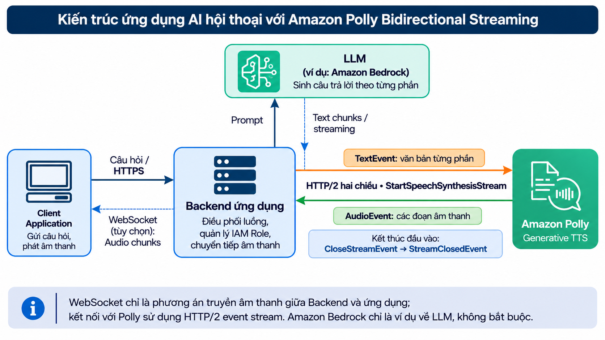

# Amazon Polly Bidirectional Streaming: Tăng tốc tổng hợp giọng nói cho ứng dụng AI hội thoại

## 1. Bối cảnh

Trong các ứng dụng AI hội thoại, người dùng thường muốn nghe câu trả lời ngay khi hệ thống bắt đầu tạo nội dung, thay vì phải chờ toàn bộ câu trả lời hoàn tất. Ví dụ, một chatbot chăm sóc khách hàng có thể sử dụng mô hình ngôn ngữ lớn (Large Language Model – LLM) để tạo câu trả lời, sau đó chuyển nội dung thành giọng nói để người dùng nghe.

LLM thường tạo văn bản theo từng phần trong quá trình xử lý. Tuy nhiên, với cách tích hợp Text-to-Speech (TTS) truyền thống, ứng dụng phải cung cấp toàn bộ văn bản trong một yêu cầu tổng hợp. Điều này khiến hệ thống phải chờ đến khi có đủ nội dung mới bắt đầu yêu cầu TTS. Nếu muốn giảm thời gian chờ, nhà phát triển thường phải tự chia văn bản thành nhiều đoạn, gửi nhiều yêu cầu tổng hợp và xử lý việc ghép các phần âm thanh.

Amazon Polly đã có thể trả âm thanh theo luồng trong phản hồi của API `SynthesizeSpeech`. Điểm hạn chế nằm ở chiều đầu vào: API này yêu cầu văn bản hoàn chỉnh trong một yêu cầu. Amazon Polly Bidirectional Streaming được giới thiệu để giải quyết vấn đề đó, cho phép ứng dụng gửi văn bản từng phần và đồng thời nhận âm thanh được tổng hợp trong cùng một phiên kết nối.

## 2. Giới thiệu Amazon Polly Bidirectional Streaming

Amazon Polly là dịch vụ Text-to-Speech được quản lý bởi AWS, có khả năng chuyển văn bản thành giọng nói tổng hợp. Dịch vụ cung cấp nhiều giọng đọc và engine khác nhau để phục vụ các nhu cầu chuyển đổi văn bản thành âm thanh.

Tính năng Bidirectional Streaming sử dụng API `StartSpeechSynthesisStream`. API này thiết lập một kết nối HTTP/2 hai chiều giữa ứng dụng và Amazon Polly. Thay vì chờ có toàn bộ văn bản, ứng dụng có thể gửi nội dung theo từng phần khi dữ liệu xuất hiện. Đồng thời, Polly tổng hợp nội dung đã nhận và gửi các đoạn âm thanh trở lại ứng dụng.

Cơ chế này có ba điểm quan trọng:

- **Gửi văn bản tăng dần:** Ứng dụng chuyển từng phần văn bản đến Polly thông qua sự kiện `TextEvent`. Các phần văn bản không bắt buộc phải trùng với ranh giới câu hoặc đoạn.
- **Nhận âm thanh đồng thời:** Polly trả dữ liệu âm thanh qua sự kiện `AudioEvent` ngay khi các phần âm thanh được tạo ra. Việc nhận âm thanh có thể diễn ra trong khi ứng dụng vẫn đang gửi thêm văn bản.
- **Đóng phiên có kiểm soát:** Khi đã gửi hết nội dung, ứng dụng gửi `CloseStreamEvent`. Polly xử lý phần văn bản còn trong bộ đệm, gửi các đoạn âm thanh cuối cùng và thông báo kết thúc bằng `StreamClosedEvent`.

Điểm mới cốt lõi không phải là Polly lần đầu tiên hỗ trợ truyền âm thanh theo luồng. Điểm mới là khả năng truyền cả văn bản đầu vào theo luồng, đồng thời nhận âm thanh đầu ra trên cùng một kết nối HTTP/2. Cách làm này đặc biệt phù hợp với nội dung được tạo liên tục từ LLM.

## 3. Mô hình kiến trúc tổng quan

*Hình 1. Mô hình kiến trúc minh họa ứng dụng AI hội thoại sử dụng Amazon Polly Bidirectional Streaming.*

Kiến trúc minh họa gồm bốn thành phần:

| Thành phần | Vai trò |
|---|---|
| Ứng dụng Web/Mobile | Nhận câu hỏi của người dùng và phát các đoạn âm thanh được chuyển về từ backend. |
| Backend ứng dụng | Tiếp nhận yêu cầu, gọi LLM, mở phiên streaming với Polly, gửi văn bản và tiếp nhận các đoạn âm thanh. |
| Mô hình ngôn ngữ lớn (LLM) | Phân tích câu hỏi và tạo câu trả lời theo từng phần. Có thể sử dụng Amazon Bedrock hoặc một nền tảng LLM khác có hỗ trợ sinh nội dung theo luồng. |
| Amazon Polly | Nhận văn bản qua `TextEvent`, tổng hợp giọng nói bằng Generative engine và trả âm thanh qua `AudioEvent`. |

Backend đóng vai trò điều phối giữa LLM, Amazon Polly và ứng dụng người dùng. Cách truyền dữ liệu âm thanh từ backend đến trình duyệt hoặc thiết bị di động là phần do nhà phát triển lựa chọn. Chẳng hạn, backend có thể sử dụng WebSocket hoặc một cơ chế streaming phù hợp. Đây là kết nối riêng của ứng dụng, không phải yêu cầu bắt buộc của giao thức HTTP/2 giữa backend và Amazon Polly.

## 4. Luồng hoạt động

Một phiên Bidirectional Streaming có thể diễn ra theo trình tự sau:

1. **Người dùng gửi câu hỏi:** Ứng dụng Web hoặc Mobile gửi nội dung đến backend.
2. **Backend gọi LLM:** Backend chuyển câu hỏi đến mô hình ngôn ngữ. LLM bắt đầu tạo câu trả lời theo từng phần thay vì phải chờ đến khi hoàn tất toàn bộ nội dung.
3. **Mở phiên với Polly:** Backend gọi `StartSpeechSynthesisStream` thông qua AWS SDK tương thích và thiết lập các tham số tổng hợp như `Engine`, `VoiceId`, `OutputFormat` và `SampleRate`.
4. **Gửi văn bản:** Mỗi khi nhận được phần nội dung mới từ LLM, backend gửi phần đó đến Polly dưới dạng `TextEvent`.
5. **Nhận âm thanh:** Trong khi backend tiếp tục gửi văn bản, Polly trả về các đoạn âm thanh qua `AudioEvent`. Backend tiếp nhận các đoạn này và chuyển về ứng dụng.
6. **Phát âm thanh:** Ứng dụng sắp xếp và bổ sung các đoạn âm thanh vào bộ đệm phát để người dùng có thể nghe khi dữ liệu đã sẵn sàng.
7. **Kết thúc phiên:** Khi LLM đã tạo xong câu trả lời, backend gửi `CloseStreamEvent`. Polly xử lý phần dữ liệu còn lại và gửi `StreamClosedEvent` để thông báo phiên tổng hợp đã hoàn tất.

Cách xử lý này giúp hai quá trình diễn ra song song: LLM tiếp tục tạo văn bản, trong khi Polly tổng hợp những phần văn bản đã nhận. Ứng dụng không cần chờ LLM hoàn tất toàn bộ câu trả lời mới bắt đầu quá trình tổng hợp giọng nói.

## 5. So sánh với API SynthesizeSpeech

Để hiểu rõ giá trị của tính năng mới, cần phân biệt Bidirectional Streaming với API `SynthesizeSpeech` vốn đã có của Amazon Polly.

`SynthesizeSpeech` hoạt động theo mô hình request–response: ứng dụng gửi toàn bộ văn bản trong một yêu cầu, sau đó nhận phản hồi âm thanh. Âm thanh trong phản hồi vẫn có thể được truyền dần khi sẵn sàng; vì vậy, khác biệt chính không nằm ở việc API cũ có hay không có audio streaming, mà nằm ở cách gửi văn bản đầu vào.

Trong khi đó, `StartSpeechSynthesisStream` cho phép gửi văn bản từng phần qua `TextEvent` và nhận âm thanh qua `AudioEvent` trong cùng một phiên HTTP/2 hai chiều.

| Tiêu chí | `SynthesizeSpeech` | `StartSpeechSynthesisStream` |
|---|---|---|
| Cách gửi văn bản | Gửi toàn bộ văn bản trong một yêu cầu | Gửi văn bản từng phần qua `TextEvent` |
| Cách nhận âm thanh | Nhận luồng âm thanh trong phản hồi HTTP | Nhận các đoạn âm thanh qua `AudioEvent` |
| Giao tiếp | Request–response | Streaming hai chiều qua HTTP/2 |
| Engine hỗ trợ | Standard, Neural, Long-form và Generative | Chỉ Generative |
| Speech Marks | Có hỗ trợ | Không hỗ trợ |
| Trường hợp phù hợp | Văn bản đã có sẵn trước khi tổng hợp | Văn bản được tạo dần, cần tổng hợp trước khi LLM hoàn tất |

Như vậy, `SynthesizeSpeech` vẫn phù hợp khi ứng dụng đã có sẵn nội dung và cần cách tích hợp đơn giản. `StartSpeechSynthesisStream` phù hợp hơn khi văn bản xuất hiện liên tục, chẳng hạn câu trả lời từ chatbot hoặc nội dung được dịch theo từng phần.

## 6. Hiệu năng trong thử nghiệm của AWS

Trong bài viết giới thiệu kỹ thuật, AWS thực hiện benchmark với cùng một nội dung gồm 7.045 ký tự, khoảng 970 từ. Thử nghiệm sử dụng giọng Matthew, Generative engine, định dạng MP3 ở tần số lấy mẫu 24 kHz tại Region US West (Oregon). AWS mô phỏng quá trình LLM tạo nội dung với tốc độ khoảng 30 mili giây mỗi từ.

| Chỉ số | Tích hợp tuần tự với `SynthesizeSpeech` | Bidirectional Streaming |
|---|---:|---:|
| Tổng thời gian xử lý | 115.226 ms (khoảng 115 giây) | 70.071 ms (khoảng 70 giây) |
| Số lần gọi API | 27 | 1 phiên streaming |
| Cách gửi nội dung | Gửi tuần tự từng câu hoàn chỉnh | Gửi văn bản dần khi nội dung được tạo |

Trong kịch bản này, AWS ghi nhận thời gian xử lý giảm khoảng 39% và số lần gọi API giảm từ 27 xuống 1. Đây là kết quả thử nghiệm với cấu hình và cách tích hợp cụ thể của AWS, không phải mức cải thiện được đảm bảo cho mọi ứng dụng. Hiệu quả thực tế còn phụ thuộc vào tốc độ sinh văn bản của LLM, độ trễ mạng, giọng đọc, cách chia dữ liệu và cơ chế phát âm thanh của ứng dụng.

## 7. Lợi ích và tình huống ứng dụng

**Giảm thời gian chờ cảm nhận:** Người dùng có thể bắt đầu nghe câu trả lời trong khi LLM vẫn đang tạo phần nội dung tiếp theo. Điều này giúp cuộc hội thoại bằng giọng nói phản hồi tự nhiên hơn.

**Giảm logic tích hợp ở phía ứng dụng:** Với cách triển khai truyền thống, nhà phát triển có thể phải tự chia nội dung, gửi nhiều yêu cầu TTS, theo dõi thứ tự và ghép các đoạn âm thanh. Bidirectional Streaming cung cấp một phiên giao tiếp hai chiều, nhờ đó giảm một phần logic điều phối và số lần gọi API.

**Hỗ trợ các ứng dụng cần phản hồi liên tục:** Tính năng có thể được sử dụng trong chatbot chăm sóc khách hàng, trợ lý ảo, hệ thống trả lời tự động qua điện thoại (IVR), ứng dụng dịch thuật hội thoại và công cụ hỗ trợ tiếp cận bằng giọng nói.

Tuy nhiên, Bidirectional Streaming không tự động giải quyết toàn bộ độ trễ của ứng dụng. Tốc độ phản hồi vẫn chịu ảnh hưởng từ thời gian xử lý của LLM, mạng, quá trình tổng hợp giọng nói và cách ứng dụng phân phối âm thanh đến người dùng.

## 8. Hạn chế và lưu ý khi triển khai

- **Chỉ hỗ trợ Generative engine:** `StartSpeechSynthesisStream` hiện yêu cầu Generative engine. Nếu ứng dụng cần Standard, Neural hoặc Long-form engine, cần lựa chọn API phù hợp khác, chẳng hạn `SynthesizeSpeech`.
- **Không hỗ trợ Speech Marks:** Ứng dụng cần dữ liệu Speech Marks để đồng bộ từ, phụ đề hoặc hoạt ảnh phải cân nhắc phương án khác.
- **Cần SDK tương thích:** Bidirectional Streaming yêu cầu AWS SDK hỗ trợ HTTP/2 event streams. AWS hiện liệt kê các SDK như Java 2.x, JavaScript v3, .NET v4, C++, Go v2, Kotlin, PHP v3, Ruby v3, Rust và Swift; AWS CLI, Python và .NET v3 chưa được hỗ trợ theo Developer Guide. Với backend Node.js, có thể sử dụng AWS SDK for JavaScript v3.
- **Có giới hạn thời gian phiên:** Một phiên streaming tối đa 10 phút. Nếu không có sự kiện đầu vào trong 5 giây, Polly có thể đóng phiên. Ứng dụng cần xử lý khoảng dừng dài và mở phiên mới khi nội dung vượt quá thời lượng cho phép.
- **Cần cân bằng độ trễ và chất lượng giọng nói:** Polly mặc định có thể đệm văn bản để tổng hợp tại ranh giới ngôn ngữ tự nhiên. Ứng dụng có thể yêu cầu flush để tổng hợp sớm hơn, nhưng flush giữa câu có thể ảnh hưởng đến ngữ điệu hoặc cách phát âm do Polly thiếu ngữ cảnh của phần nội dung tiếp theo.
- **Cần kiểm tra Region và giọng đọc:** Trước khi triển khai, cần xác nhận Generative engine và giọng đọc mong muốn có sẵn tại AWS Region đang sử dụng. Không nên mặc định mọi ngôn ngữ hoặc mọi giọng Polly đều tương thích với Bidirectional Streaming.

Ngoài ra, thông tin xác thực AWS nên được quản lý ở backend bằng IAM Role hoặc cơ chế cấp quyền phù hợp. Không nên đưa Access Key và Secret Access Key dài hạn vào mã JavaScript chạy trực tiếp trên trình duyệt hoặc ứng dụng di động.

## 9. Kết luận

Amazon Polly Bidirectional Streaming mở rộng khả năng tổng hợp giọng nói bằng cách cho phép ứng dụng gửi văn bản đầu vào theo luồng và nhận âm thanh đầu ra đồng thời qua một kết nối HTTP/2. Đây là điểm cải tiến quan trọng đối với các ứng dụng AI hội thoại, nơi nội dung thường được tạo dần bởi LLM.

Tính năng có thể giúp giảm thời gian chờ cảm nhận của người dùng và đơn giản hóa một phần quá trình tích hợp TTS. Tuy nhiên, việc lựa chọn API vẫn cần dựa trên đặc điểm ứng dụng: `StartSpeechSynthesisStream` phù hợp với văn bản được tạo liên tục, còn `SynthesizeSpeech` vẫn là lựa chọn hợp lý khi văn bản đã có sẵn hoặc cần các engine và tính năng mà API streaming chưa hỗ trợ.

## Tài liệu tham khảo

- AWS Machine Learning Blog, [Introducing Amazon Polly Bidirectional Streaming: Real-time speech synthesis for conversational AI](https://aws.amazon.com/blogs/machine-learning/introducing-amazon-polly-bidirectional-streaming-real-time-speech-synthesis-for-conversational-ai/), 26/03/2026.
- AWS What's New, [Amazon Polly expands Generative TTS engine with 10 new voices, 2 new regions, and Bidirectional Streaming API](https://aws.amazon.com/about-aws/whats-new/2026/03/amazon-polly-expands-TTS-new-voices-and-bidirectional-streaming/), 20/03/2026.
- Amazon Polly Developer Guide, [Synthesizing speech with bidirectional streaming](https://docs.aws.amazon.com/polly/latest/dg/bidirectional-streaming.html).
- Amazon Polly Developer Guide, [SynthesizeSpeech and StartSpeechSynthesisStream compared](https://docs.aws.amazon.com/polly/latest/dg/bidirectional-streaming-choosing.html).
- Amazon Polly Developer Guide, [Sending text and receiving audio](https://docs.aws.amazon.com/polly/latest/dg/bidirectional-streaming-lifecycle.html).
