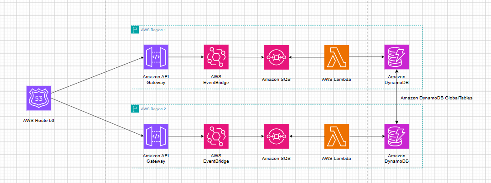

# Kiến trúc xử lý đơn hàng đa Region trên AWS: Cách chuyển hướng yêu cầu mới sang Region dự phòng khi Region chính gặp sự cố

Một nền tảng thương mại điện tử có thể tiếp nhận nhiều yêu cầu đặt hàng trong ngày. Khi khách hàng nhấn nút đặt hàng, hệ thống cần tiếp nhận yêu cầu, ghi nhận thông tin, đưa sự kiện vào quy trình xử lý và lưu lại kết quả. Nếu toàn bộ ứng dụng chỉ hoạt động tại một AWS Region, sự cố nghiêm trọng tại khu vực đó có thể khiến khách hàng không gửi được yêu cầu mới, đồng thời làm gián đoạn quá trình xử lý các sự kiện đang chờ.

Một cách giảm rủi ro là chuẩn bị thêm một AWS Region để dự phòng. Tuy nhiên, chỉ triển khai thêm tài nguyên tại khu vực thứ hai chưa đủ. Hệ thống còn phải phát hiện khi Region chính gặp sự cố, chuyển các yêu cầu mới đến Region dự phòng, tiếp tục xử lý sự kiện và bảo đảm dữ liệu cần thiết có thể được truy cập ở khu vực thay thế.

Để giải quyết bài toán này, kiến trúc **Multi-Region Event-Driven Failover** kết hợp Amazon Route 53, Amazon API Gateway, Amazon EventBridge, Amazon SQS, AWS Lambda và Amazon DynamoDB Global Tables. Kiến trúc sử dụng mô hình **Active-Passive**: Region chính xử lý lưu lượng trong điều kiện bình thường, còn Region dự phòng được chuẩn bị sẵn để tiếp nhận yêu cầu khi endpoint của Region chính không còn đáp ứng Health Check.

Tình huống cửa hàng trực tuyến trong bài viết là ví dụ giả định, được sử dụng để minh họa cách kiến trúc vận hành. Đây không phải câu chuyện khách hàng hay một hệ thống thương mại điện tử cụ thể đã được triển khai.

## 1. BÀI TOÁN THỰC TẾ: ĐIỀU GÌ XẢY RA KHI REGION CHÍNH GẶP SỰ CỐ?

### 1.1. Rủi ro khi ứng dụng chỉ triển khai tại một Region

AWS Region là một khu vực địa lý riêng biệt trong hạ tầng AWS. Một Region có thể bao gồm nhiều Availability Zone (AZ), giúp ứng dụng tăng khả năng chịu lỗi trong phạm vi khu vực đó. Tuy nhiên, nếu toàn bộ ứng dụng chỉ được triển khai tại một Region, sự cố ảnh hưởng đến khu vực này vẫn có thể làm gián đoạn dịch vụ trên phạm vi lớn hơn.

Ví dụ, một cửa hàng trực tuyến tiếp nhận đơn hàng thông qua API. Khi khách hàng gửi yêu cầu, hệ thống cần ghi nhận sự kiện, đưa sự kiện vào quy trình xử lý và cập nhật dữ liệu đơn hàng. Nếu endpoint API tại Region đang hoạt động gặp sự cố, các yêu cầu mới có thể không được tiếp nhận. Các thành phần xử lý sự kiện phụ thuộc vào Region đó cũng có thể bị ảnh hưởng.

Trong tình huống này, doanh nghiệp không chỉ cần khôi phục giao diện ứng dụng. Hệ thống còn phải xác định những yêu cầu nào đã được tiếp nhận, những thông điệp nào còn chờ xử lý, dữ liệu nào đã được ghi nhận và cách tiếp tục phục vụ khách hàng mà không tạo ra đơn hàng trùng lặp hoặc trạng thái giao dịch sai lệch.

### 1.2. Những vấn đề cần giải quyết

Việc triển khai thêm một Region chỉ có ý nghĩa khi khu vực dự phòng có thể thay thế Region chính trong phạm vi nghiệp vụ cần thiết. Để làm được điều đó, hệ thống cần giải quyết ba vấn đề liên kết với nhau:

1. **Phát hiện sự cố:** Xác định endpoint tại Region chính có còn đáp ứng điều kiện phục vụ hay không.
2. **Điều hướng yêu cầu:** Chuyển các truy vấn DNS mới đến endpoint của Region dự phòng khi Region chính không khỏe mạnh.
3. **Duy trì xử lý và dữ liệu:** Chuẩn bị sẵn pipeline xử lý tại Region dự phòng và duy trì bản sao dữ liệu để khu vực này có thể tiếp tục hoạt động.

Multi-AZ và Multi-Region cũng cần được phân biệt. Multi-AZ tập trung vào khả năng chịu lỗi giữa các Availability Zone trong cùng một Region. Multi-Region mở rộng phương án phục hồi sang một khu vực AWS khác, nhưng thường đòi hỏi chi phí và công sức vận hành cao hơn.

## 2. TỔNG QUAN KIẾN TRÚC GIẢI PHÁP

### 2.1. Mô hình kiến trúc tổng thể

Giải pháp sử dụng hai AWS Region theo mô hình Active-Passive. Trong điều kiện bình thường, Primary Region tiếp nhận và xử lý lưu lượng. Secondary Region được chuẩn bị sẵn với các thành phần cần thiết để tiếp nhận yêu cầu khi xảy ra chuyển đổi.

Mỗi Region có một pipeline xử lý sự kiện riêng gồm:

**Amazon API Gateway → Amazon EventBridge → Amazon SQS → AWS Lambda → Amazon DynamoDB**

Amazon Route 53 quản lý tên miền chung và các bản ghi định tuyến Primary/Secondary. Health Check theo dõi endpoint API Gateway được cấu hình. Amazon DynamoDB Global Tables duy trì các bản sao dữ liệu giữa hai Region.

**Sơ đồ kiến trúc:**

*Hình 1. Kiến trúc xử lý sự kiện đa Region theo mô hình Active-Passive. Nguồn hình: AWS Compute Blog – “Multi-Region event-driven failover architecture with Amazon EventBridge and Route 53” (01/06/2026).*

Có thể đọc sơ đồ theo ba nhóm chức năng:

1. **Điều hướng truy cập:** Route 53 phân giải tên miền đến endpoint của Region được chọn.
2. **Tiếp nhận và xử lý sự kiện:** API Gateway tiếp nhận yêu cầu; EventBridge định tuyến sự kiện; SQS lưu thông điệp; Lambda xử lý nghiệp vụ.
3. **Lưu trữ và nhân bản dữ liệu:** Lambda ghi dữ liệu vào DynamoDB tại Region đang hoạt động; Global Tables nhân bản thay đổi sang Replica ở Region còn lại.

Hai pipeline xử lý được triển khai độc lập theo Region. EventBridge Bus, SQS Queue và Lambda tại Secondary Region là những tài nguyên riêng, không phải hàng đợi hoặc hàm Lambda dùng chung xuyên Region. Lambda Event Source Mapping và SQS Queue mà nó đọc phải nằm trong cùng AWS Region.

Nếu sử dụng cùng một tên miền tùy chỉnh cho API Gateway tại cả hai Region, custom domain cần được cấu hình ở từng Region và phải có chứng chỉ SSL/TLS phù hợp trong AWS Certificate Manager tại từng Region. Trong cấu hình minh họa, Health Check theo dõi endpoint API Gateway theo tên miền `execute-api` của Region, với đường dẫn `/Prod/health` và cổng HTTPS 443.

### 2.2. Phân biệt luồng DNS và luồng xử lý sự kiện

Trong kiến trúc này có hai luồng hoạt động khác nhau:

- **Luồng điều hướng:** Người dùng truy cập tên miền chung. Route 53 trả lời truy vấn DNS bằng bản ghi Primary hoặc Secondary tùy trạng thái Health Check và Failover Routing Policy.
- **Luồng xử lý sự kiện:** Sau khi yêu cầu đến API Gateway tại một Region, API Gateway gửi sự kiện đến EventBridge Bus của Region đó. EventBridge định tuyến sự kiện phù hợp đến SQS; Lambda đọc thông điệp và ghi dữ liệu vào DynamoDB Replica tại Region tương ứng.

Route 53 không trực tiếp chuyển tiếp từng gói tin HTTP hoặc di chuyển kết nối đang mở giữa hai Region. Dịch vụ này tham gia ở bước phân giải DNS. Sau khi nhận được câu trả lời DNS, trình duyệt hoặc ứng dụng mới kết nối đến endpoint được trả về. Vì vậy, DNS Failover không tự động chuyển các kết nối đang tồn tại sang Region khác.

## 3. KHI HỆ THỐNG HOẠT ĐỘNG BÌNH THƯỜNG

### 3.1. Khách hàng gửi yêu cầu đặt hàng

Khi khách hàng nhấn **Đặt hàng**, ứng dụng gửi một HTTP request đến tên miền chung của hệ thống. Trong trạng thái bình thường, Route 53 phân giải tên miền đến endpoint API Gateway tại Primary Region.

API Gateway tiếp nhận dữ liệu của yêu cầu, chẳng hạn mã đơn hàng, mã khách hàng và thông tin sản phẩm. Sau đó, API Gateway sử dụng tích hợp dịch vụ AWS (AWS service integration) để gửi sự kiện đến EventBridge thông qua API `PutEvents`. Trong ví dụ này, loại sự kiện `OrderCreated` được giả định là tên do ứng dụng đặt ra để biểu thị một yêu cầu tạo đơn hàng.

Cần phân biệt **tiếp nhận sự kiện** với **hoàn tất xử lý đơn hàng**. Việc API Gateway gửi sự kiện đến EventBridge không có nghĩa Lambda đã xử lý xong hoặc toàn bộ nghiệp vụ đặt hàng đã hoàn tất. Đây là quy trình bất đồng bộ: sự kiện được tiếp nhận trước, còn các bước xử lý phía sau diễn ra tiếp theo.

Một điểm cần kiểm tra là phản hồi của `PutEvents`. HTTP 200 không đảm bảo mọi entry trong yêu cầu đều được tiếp nhận thành công. Khi gửi nhiều entry, EventBridge có thể xử lý thành công một số entry nhưng trả lỗi cho những entry khác. Ứng dụng cần kiểm tra `FailedEntryCount` và thông tin lỗi của từng entry để biết sự kiện nào cần được gửi lại. Ngoài ra, nếu gửi sự kiện đến Event Bus không tồn tại, EventBridge có thể vẫn trả HTTP 200 nhưng sự kiện bị bỏ mà không được tính vào `FailedEntryCount`. Vì vậy, tên và sự tồn tại của Event Bus cũng cần được kiểm soát.

Nếu hệ thống mới xác nhận sự kiện đã được tiếp nhận, giao diện nên thông báo trạng thái như “Đã tiếp nhận yêu cầu đặt hàng”. Chỉ nên hiển thị “Đặt hàng thành công” sau khi các điều kiện nghiệp vụ cần thiết đã được xác nhận.

### 3.2. Sự kiện được phân phối đến hàng đợi

Sau khi EventBridge nhận sự kiện, dịch vụ kiểm tra các Event Rules đã cấu hình trên Event Bus. Rule xác định loại sự kiện hoặc mẫu dữ liệu cần khớp. Khi sự kiện thỏa mãn điều kiện, EventBridge gửi sự kiện đến Target tương ứng. Trong kiến trúc này, Target là một SQS Queue thuộc cùng Region.

Ví dụ, sự kiện `OrderCreated` có thể khớp với Rule dành cho yêu cầu tạo đơn hàng. EventBridge chuyển sự kiện đó đến hàng đợi để chờ xử lý.

SQS đóng vai trò vùng đệm giữa thời điểm tiếp nhận yêu cầu và thời điểm xử lý nghiệp vụ. Nếu nhiều khách hàng đặt hàng trong một khoảng thời gian ngắn, thông điệp có thể được lưu trong hàng đợi thay vì buộc API phải chờ Lambda xử lý từng yêu cầu. Điều này giúp tách tốc độ tiếp nhận khỏi tốc độ xử lý, nhưng không có nghĩa thông điệp chắc chắn được xử lý ngay lập tức hoặc thành công ở lần đầu.

### 3.3. Lambda xử lý thông điệp và ghi dữ liệu

Lambda được cấu hình để đọc thông điệp từ SQS thông qua Event Source Mapping. Lambda polling hàng đợi, nhận thông điệp theo từng batch và thực hiện hàm xử lý. Khi xử lý thành công toàn bộ batch, các thông điệp tương ứng được xóa khỏi hàng đợi. Nếu hàm xử lý thất bại, theo hành vi mặc định, các thông điệp trong batch có thể hiển thị trở lại sau khi Visibility Timeout kết thúc để được thử xử lý lại.

Trong ví dụ đặt hàng, Lambda có thể kiểm tra thông tin sản phẩm, xác thực dữ liệu cần thiết, ghi nhận đơn hàng và cập nhật trạng thái xử lý vào DynamoDB tại Primary Region. Các bước nghiệp vụ cụ thể phụ thuộc vào thiết kế ứng dụng; kiến trúc minh họa tập trung vào luồng tiếp nhận, xếp hàng, xử lý và ghi dữ liệu.

Do SQS và Lambda hoạt động theo cơ chế **at-least-once delivery**, một thông điệp có thể được xử lý nhiều lần. Vì vậy, ứng dụng cần thiết kế logic **Idempotency** để việc xử lý lại cùng một yêu cầu không tạo ra tác động nghiệp vụ ngoài ý muốn.

Đối với đơn hàng, nên sử dụng một khóa Idempotency ổn định ở cấp nghiệp vụ, chẳng hạn mã yêu cầu do ứng dụng khách tạo và giữ nguyên trong các lần thử lại. Hệ thống có thể dùng khóa này để kiểm tra yêu cầu đã được xử lý hay chưa trước khi tạo đơn hàng mới. Khóa cần được lưu và kiểm tra một cách nhất quán; chỉ dựa vào ID của sự kiện EventBridge là chưa đủ cho mọi trường hợp.

Cần phân biệt hai loại mã:

- **ID sự kiện EventBridge:** EventBridge cấp ID khi tiếp nhận mỗi sự kiện qua `PutEvents`. Khi cùng một thông điệp SQS được giao lại, ID sự kiện bên trong thông điệp vẫn giữ nguyên, nên có thể hỗ trợ nhận diện lần xử lý lặp của chính sự kiện đó.
- **Khóa Idempotency của đơn hàng:** Được ứng dụng tạo và giữ nguyên khi gửi lại cùng một yêu cầu nghiệp vụ. Nếu khách hàng gửi lại request và hệ thống gọi `PutEvents` lần nữa, EventBridge có thể cấp ID sự kiện mới. Khóa nghiệp vụ ổn định mới giúp nhận diện đây vẫn là cùng một yêu cầu đặt hàng.

### 3.4. Dữ liệu được nhân bản sang Region dự phòng

Sau khi Lambda ghi dữ liệu vào DynamoDB tại Primary Region, DynamoDB Global Tables tự động nhân bản thay đổi sang các Replica của bảng tại những Region đã cấu hình. Nhờ vậy, ứng dụng tại Secondary Region có thể truy cập bản sao dữ liệu cục bộ khi cần tiếp nhận lưu lượng.

Trong cấu hình minh họa, Global Table được tạo với các Replica ở hai Region nhưng không chỉ định chế độ nhất quán khác. Khi không chỉ định chế độ, DynamoDB Global Tables mặc định sử dụng **Multi-Region Eventual Consistency (MREC)**. Với MREC, thay đổi được nhân bản bất đồng bộ, thường trong khoảng một giây hoặc ít hơn, nhưng đây không phải cam kết thời gian cố định. Độ trễ thực tế phụ thuộc Region, tải và các yếu tố vận hành.

Cũng cần phân biệt mô hình Active-Passive ở tầng ứng dụng với khả năng multi-active của DynamoDB Global Tables. Ứng dụng trong kiến trúc này ưu tiên xử lý lưu lượng tại Primary Region, nhưng các Replica của Global Tables vẫn có thể nhận thao tác đọc và ghi. Trong giai đoạn chuyển đổi, DNS cache có thể khiến một số người dùng vẫn truy cập Primary trong khi người dùng khác đã được điều hướng sang Secondary. Nếu cả hai Region cập nhật cùng một mục dữ liệu trong khoảng thời gian nhân bản, xung đột ghi có thể xảy ra. Với MREC, DynamoDB giải quyết xung đột ở cấp mục dữ liệu bằng cơ chế **last writer wins**, dựa trên dấu thời gian nội bộ của lần ghi.

## 4. KHI REGION CHÍNH GẶP SỰ CỐ, HỆ THỐNG CHUYỂN ĐỔI NHƯ THẾ NÀO?

Hãy tiếp tục tình huống cửa hàng trực tuyến. Trong giờ cao điểm, endpoint API Gateway tại Primary Region không còn phản hồi theo điều kiện Health Check đã cấu hình. Nếu không có cơ chế dự phòng, người dùng có thể tiếp tục gửi yêu cầu đến endpoint gặp lỗi.

### 4.1. Route 53 phát hiện endpoint không khỏe mạnh

Route 53 sử dụng Health Check để gửi yêu cầu kiểm tra đến endpoint API Gateway của Region chính. Cấu hình minh họa sử dụng HTTPS, đường dẫn `/Prod/health`, cổng 443, chu kỳ kiểm tra 30 giây và Failure Threshold bằng 3.

Với Health Check HTTP/HTTPS, mỗi health checker cần thiết lập được kết nối TCP đến endpoint trong thời gian quy định và nhận được mã trạng thái HTTP 2xx hoặc 3xx trong thời gian phản hồi cho phép. Route 53 sử dụng các health checker ở nhiều vị trí và tổng hợp kết quả để đánh giá trạng thái endpoint. Health Check HTTPS cũng không xác thực tính hợp lệ hoặc thời hạn của chứng chỉ SSL/TLS.

Khi endpoint không đáp ứng số lần kiểm tra liên tiếp theo ngưỡng, Route 53 có thể đánh giá bản ghi Primary là không khỏe mạnh. Với Failover Routing Policy, các truy vấn DNS mới có thể được trả về bản ghi Secondary nếu bản ghi dự phòng đáp ứng điều kiện cấu hình.

Cần hiểu đúng về mốc thời gian: chu kỳ 30 giây và ngưỡng 3 lần tương ứng khoảng 90 giây theo cách tính đơn giản của cấu hình mẫu. Tuy nhiên, đây không phải cam kết rằng toàn bộ ứng dụng sẽ phục hồi sau đúng 90 giây. Việc đánh giá trạng thái dựa trên nhiều health checker, sau đó còn có DNS TTL, cache của resolver và khả năng tiếp nhận của Region dự phòng. Trong phần thử nghiệm minh họa, thời gian chờ được hướng dẫn là khoảng 2–3 phút.

Health Check cũng chỉ phản ánh endpoint và điều kiện mà nó được cấu hình để kiểm tra. Nếu `/Prod/health` chỉ trả về mã thành công khi API Gateway phản hồi mà không kiểm tra những phụ thuộc quan trọng phía sau, Route 53 có thể vẫn xem endpoint là khỏe mạnh ngay cả khi EventBridge, SQS, Lambda hoặc DynamoDB đang gặp lỗi. Do đó, nội dung của endpoint kiểm tra sức khỏe cần được thiết kế phù hợp với mức độ sẵn sàng mà ứng dụng muốn đánh giá.

### 4.2. Các yêu cầu mới được điều hướng đến Region dự phòng

Khi bản ghi Primary bị đánh giá không khỏe mạnh, Route 53 có thể trả về bản ghi Secondary cho các truy vấn DNS mới. Ứng dụng phân giải lại tên miền và nhận endpoint API Gateway tại Secondary Region.

Yêu cầu đặt hàng mới sau đó đi vào pipeline riêng của Region dự phòng:

1. API Gateway tại Secondary Region tiếp nhận HTTP request.
2. API Gateway gửi sự kiện đến EventBridge Bus tại Secondary Region thông qua `PutEvents`.
3. EventBridge kiểm tra Rule và chuyển sự kiện phù hợp đến SQS Queue của Region này.
4. Lambda tại Secondary Region đọc thông điệp và thực hiện xử lý.
5. Lambda ghi dữ liệu vào Replica DynamoDB tại Secondary Region.
6. DynamoDB Global Tables nhân bản thay đổi sang các Replica khác theo chế độ đã cấu hình.

Nhờ có pipeline riêng và dữ liệu được nhân bản liên Region, Secondary Region có thể tiếp tục tiếp nhận và xử lý các yêu cầu mới được điều hướng đến đó. Đây là ý nghĩa chính của cơ chế failover trong kiến trúc này.

Tuy nhiên, DNS cache có thể khiến quá trình chuyển đổi không đồng thời với mọi người dùng. Một số ứng dụng vẫn có thể gửi yêu cầu đến endpoint cũ trong khoảng thời gian còn lưu kết quả DNS. Vì vậy, cần có timeout, retry có kiểm soát và khóa Idempotency ổn định ở cấp nghiệp vụ.

### 4.3. Những yêu cầu đã gửi trước khi sự cố xảy ra được xử lý ra sao?

Mỗi Region có một SQS Queue riêng. Hàng đợi tại Primary Region không tự động được sao chép sang SQS tại Secondary Region trong kiến trúc này.

Vì vậy, nếu một yêu cầu đã được tiếp nhận và đang chờ xử lý trong SQS của Primary Region ngay trước khi sự cố xảy ra, không thể mặc định thông điệp đó sẽ tự xuất hiện trong hàng đợi của Secondary Region. Hàng đợi cũ vẫn thuộc Region ban đầu; khả năng truy cập và tiếp tục xử lý thông điệp còn phụ thuộc tình trạng hoạt động của Region đó.

Đối với hệ thống đặt hàng thực tế, doanh nghiệp cần có cách đối soát các yêu cầu đã được tiếp nhận nhưng chưa có kết quả cuối cùng. Có thể sử dụng mã đơn hàng hoặc khóa Idempotency để kiểm tra trạng thái, cho phép khách hàng thử lại an toàn và tránh tạo đơn hàng trùng. Đây là yêu cầu thiết kế nghiệp vụ bổ sung, không phải chức năng tự động được đảm bảo chỉ bằng DNS Failover.

### 4.4. Vì sao người dùng có thể vẫn gặp lỗi trong một khoảng thời gian?

Route 53 thay đổi câu trả lời DNS, chứ không trực tiếp chuyển từng kết nối mạng đang hoạt động. DNS Resolver, trình duyệt hoặc ứng dụng có thể còn lưu địa chỉ của Primary Region trong bộ nhớ đệm đến khi TTL hoặc thời hạn cache hết hiệu lực. Những kết nối đã mở đến endpoint cũ cũng không tự động được chuyển sang Region dự phòng.

Do đó, trong thời gian chuyển đổi, một số yêu cầu có thể vẫn đi đến endpoint cũ và thất bại. Ứng dụng cần có cơ chế timeout, phân giải DNS lại và retry có kiểm soát. Khóa Idempotency phải được giữ nguyên qua các lần thử lại để một yêu cầu đặt hàng không bị ghi nhận nhiều lần.

## 5. KHI REGION CHÍNH PHỤC HỒI, ĐIỀU GÌ XẢY RA?

Khi endpoint tại Primary Region hoạt động trở lại và đáp ứng điều kiện Health Check, Route 53 có thể đánh giá bản ghi Primary là khỏe mạnh và tiếp tục ưu tiên bản ghi này theo Failover Routing Policy. Trong cấu hình minh họa, sau khi khôi phục endpoint, lưu lượng được định tuyến trở lại Primary sau khoảng 2–3 phút. Đây là kết quả của cấu hình thử nghiệm, không phải thời gian phục hồi được bảo đảm cho mọi hệ thống.

Failback cũng không nhất thiết xảy ra đồng thời với mọi người dùng. Một số DNS Resolver vẫn có thể giữ kết quả phân giải cũ trong thời gian TTL hoặc cache còn hiệu lực. Vì vậy, một số yêu cầu có thể vẫn đến Secondary Region dù Primary đã phục hồi.

Trong thời gian Secondary Region xử lý yêu cầu, các thay đổi được ghi vào DynamoDB Global Tables sẽ được nhân bản về các Replica khác theo chế độ nhất quán đã cấu hình. Với MREC, quá trình nhân bản là bất đồng bộ. Nếu một Region tạm thời bị cô lập, những thay đổi chưa kịp nhân bản sẽ tiếp tục được thử nhân bản khi Replica hoạt động trở lại. Tuy nhiên, dữ liệu mới chưa được nhân bản có thể chưa sẵn sàng để ứng dụng ở Region còn lại đọc trong thời gian sự cố.

Ngoài dữ liệu, doanh nghiệp cần xem xét những thông điệp còn tồn tại trong SQS của Region chính trước khi kết luận hệ thống đã trở về trạng thái bình thường. Endpoint hoạt động trở lại không đồng nghĩa mọi thông điệp tồn đọng, dữ liệu và quy trình nghiệp vụ đã được đối soát xong.

## 6. NHỮNG LỢI ÍCH VÀ GIỚI HẠN CẦN CÂN NHẮC

### 6.1. Những vấn đề kiến trúc giải quyết

- **Giảm phụ thuộc vào một Region:** Khi endpoint chính không còn khỏe mạnh, Route 53 có thể điều hướng các truy vấn DNS mới đến Region dự phòng, tạo một đường tiếp nhận thay thế.
- **Duy trì pipeline xử lý tại Region dự phòng:** Secondary Region có API Gateway, EventBridge, SQS và Lambda riêng để xử lý các sự kiện mới được chuyển đến.
- **Tách biệt tiếp nhận và xử lý:** EventBridge định tuyến sự kiện theo Rule, còn SQS giữ thông điệp để Lambda xử lý sau. Việc tiếp nhận yêu cầu và xử lý nghiệp vụ được tách thành các giai đoạn.
- **Duy trì bản sao dữ liệu liên vùng:** DynamoDB Global Tables nhân bản dữ liệu đến các Region đã cấu hình, hỗ trợ ứng dụng truy cập dữ liệu tại khu vực dự phòng khi cần chuyển đổi.

### 6.2. Những giới hạn và rủi ro cần hiểu đúng

**Chuyển đổi DNS không tức thời:** Health Check cần thời gian phát hiện lỗi; DNS TTL và cache có thể khiến người dùng tiếp tục sử dụng endpoint cũ. Kết nối đang mở không tự động được chuyển vùng.

**Health Check không mặc nhiên kiểm tra toàn bộ nghiệp vụ:** Nếu endpoint kiểm tra không xác minh các phụ thuộc quan trọng, hệ thống có thể vẫn được đánh giá là khỏe mạnh dù một thành phần phía sau đang lỗi. Cần thiết kế nội dung Health Check phù hợp với cách ứng dụng vận hành.

**Hàng đợi không tự động chuyển Region:** SQS ở Primary và Secondary là hai hàng đợi riêng. Các thông điệp đang chờ tại Primary không tự động được sao chép sang Secondary trong kiến trúc này.

**Thông điệp có thể được xử lý lặp:** Lambda tích hợp với SQS theo cơ chế at-least-once. Ứng dụng cần xử lý Idempotent dựa trên khóa nghiệp vụ ổn định, không chỉ dựa vào ID sự kiện EventBridge.

**Dữ liệu có thể có độ trễ nhân bản:** MREC sao chép bất đồng bộ. Khi sự cố xảy ra ngay sau một lần ghi, Replica ở Region khác có thể chưa nhận được thay đổi mới nhất. Nếu cùng một mục bị cập nhật tại nhiều Region, cơ chế last writer wins có thể quyết định phiên bản cuối cùng.

**Chi phí và độ phức tạp vận hành tăng:** Doanh nghiệp phải duy trì tài nguyên ở nhiều Region, theo dõi Health Check, quản lý cấu hình và quyền IAM, giám sát độ trễ nhân bản, kiểm tra failover/failback và tính đến chi phí truyền dữ liệu liên Region.

### 6.3. RTO và RPO – Hai mục tiêu cần xác định trước

Khi thiết kế Disaster Recovery, doanh nghiệp cần xác định hai mục tiêu quan trọng:

- **Recovery Time Objective (RTO):** Khoảng thời gian gián đoạn tối đa mà doanh nghiệp có thể chấp nhận trước khi dịch vụ phải khôi phục.
- **Recovery Point Objective (RPO):** Mức mất dữ liệu tối đa có thể chấp nhận, thường được biểu diễn bằng khoảng thời gian dữ liệu có thể bị mất.

Không thể lấy thời gian Health Check khoảng 90 giây trong cấu hình minh họa làm RTO của toàn bộ hệ thống. RTO thực tế còn phụ thuộc thời gian phát hiện sự cố, DNS cache, khả năng tiếp nhận của Secondary Region, việc xử lý lại yêu cầu thất bại, trạng thái hàng đợi và khả năng hoạt động của các phụ thuộc.

Với MREC, nhân bản dữ liệu là bất đồng bộ nên RPO phụ thuộc vào độ trễ nhân bản tại thời điểm xảy ra sự cố. Không nên khẳng định RPO bằng 0 chỉ vì hệ thống sử dụng DynamoDB Global Tables.

DynamoDB còn hỗ trợ **Multi-Region Strong Consistency (MRSC)**. Chế độ này cung cấp cơ chế nhất quán mạnh liên Region và RPO bằng 0 theo mô hình Global Tables, nhưng phải được thiết kế ngay từ khi tạo bảng. MRSC yêu cầu triển khai chính xác ba Region: ba Replica hoặc hai Replica cộng một Witness. Chế độ này có độ trễ ghi cao hơn do cần giao tiếp liên Region và không thể chuyển một Global Table đã tạo từ MREC sang MRSC. Vì vậy, MRSC không phải lựa chọn có thể thay trực tiếp vào kiến trúc hai Region đang phân tích.

### 6.4. Tự động hay thủ công khi chuyển đổi Region?

Cơ chế trong kiến trúc này sử dụng Health Check và Route 53 để tự động chuyển hướng DNS khi endpoint chính bị đánh giá không khỏe mạnh. Cách làm này có thể rút ngắn thời gian cần thao tác của đội vận hành.

Tuy nhiên, failover tự động dựa trên Health Check hoặc cảnh báo cần được cân nhắc. Một lần đánh giá sai có thể khiến hệ thống chuyển Region không cần thiết, gây gián đoạn hoặc phát sinh rủi ro dữ liệu. AWS Well-Architected Framework lưu ý rằng trong một số tình huống, tổ chức chọn kích hoạt failover thủ công nhưng vẫn tự động hóa các bước thực hiện để thao tác khôi phục nhanh và nhất quán.

Do đó, lựa chọn tự động hay thủ công cần dựa trên RTO, mức độ quan trọng của dữ liệu, khả năng phát hiện sự cố và mức độ tin cậy của cơ chế Health Check.

### 6.5. Khi nào kiến trúc này phù hợp?

Kiến trúc Multi-Region Event-Driven Failover phù hợp để xem xét đối với các ứng dụng:

- Có yêu cầu duy trì khả năng tiếp nhận yêu cầu khi một Region gặp sự cố.
- Có luồng xử lý sự kiện có thể tách thành các bước tiếp nhận, định tuyến, lưu hàng đợi và xử lý nền.
- Có thể sử dụng mô hình Active-Passive và chấp nhận đặc điểm về DNS Failover, độ trễ nhân bản dữ liệu và thời gian phục hồi.
- Có đủ nguồn lực để vận hành, giám sát, kiểm thử và chi trả cho hạ tầng ở nhiều Region.

Ngược lại, nếu ứng dụng chỉ cần khả năng chịu lỗi trong phạm vi một AZ hoặc một Region và không có yêu cầu phục hồi liên vùng rõ ràng, doanh nghiệp nên đánh giá phương án Multi-AZ trước khi đầu tư vào Multi-Region. Lựa chọn kiến trúc cần dựa trên yêu cầu nghiệp vụ, không chỉ dựa trên số lượng dịch vụ AWS có thể kết hợp.

## 7. KẾT LUẬN

Kiến trúc Multi-Region Event-Driven Failover kết hợp Amazon Route 53, Amazon API Gateway, Amazon EventBridge, Amazon SQS, AWS Lambda và Amazon DynamoDB Global Tables nhằm hỗ trợ ứng dụng tiếp tục tiếp nhận và xử lý sự kiện khi endpoint tại Region chính gặp sự cố.

Trong tình huống cửa hàng trực tuyến, Route 53 điều hướng các truy vấn DNS mới đến Region dự phòng; API Gateway tiếp nhận yêu cầu; EventBridge định tuyến sự kiện; SQS lưu thông điệp để chờ xử lý; Lambda thực hiện nghiệp vụ; DynamoDB Global Tables nhân bản dữ liệu giữa các Region. Mỗi thành phần đảm nhiệm một phần riêng của quy trình và phối hợp để hỗ trợ duy trì hoạt động khi xảy ra sự cố.

Tuy nhiên, triển khai thêm một Region không tự động bảo đảm hệ thống không gián đoạn hoặc không mất dữ liệu. DNS Failover có độ trễ; Health Check chỉ phản ánh endpoint và điều kiện được kiểm tra; SQS tại mỗi Region là hàng đợi riêng; Lambda có thể xử lý lặp thông điệp; DynamoDB Global Tables ở chế độ MREC có độ trễ nhân bản và khả năng xung đột ghi cần được xem xét.

Vì vậy, trước khi áp dụng, doanh nghiệp cần xác định RTO và RPO, thiết kế Health Check phù hợp, xây dựng khóa Idempotency ổn định cho nghiệp vụ, lập kế hoạch đối soát thông điệp chưa hoàn tất và kiểm thử định kỳ kịch bản Failover/Failback. Khả năng phục hồi không chỉ phụ thuộc vào việc có thêm một Region, mà còn phụ thuộc vào cách hệ thống xử lý yêu cầu, dữ liệu và trạng thái nghiệp vụ trong suốt quá trình chuyển đổi.

## TÀI LIỆU THAM KHẢO

- AWS Compute Blog – *Multi-Region event-driven failover architecture with Amazon EventBridge and Route 53* (01/06/2026):  
  https://aws.amazon.com/blogs/compute/multi-region-event-driven-failover-architecture-with-amazon-eventbridge-and-route-53/
- Amazon Route 53 – *Failover routing*:  
  https://docs.aws.amazon.com/Route53/latest/DeveloperGuide/routing-policy-failover.html
- Amazon Route 53 – *How Amazon Route 53 determines whether a health check is healthy*:  
  https://docs.aws.amazon.com/Route53/latest/DeveloperGuide/dns-failover-determining-health-of-endpoints.html
- Amazon EventBridge – *Rules in Amazon EventBridge*:  
  https://docs.aws.amazon.com/eventbridge/latest/userguide/eb-rules.html
- Amazon EventBridge – *Sending events with PutEvents*:  
  https://docs.aws.amazon.com/eventbridge/latest/userguide/eb-putevents.html
- AWS Lambda – *Using Lambda with Amazon SQS*:  
  https://docs.aws.amazon.com/lambda/latest/dg/with-sqs.html
- Amazon DynamoDB – *Global tables – multi-active, multi-Region replication*:  
  https://docs.aws.amazon.com/amazondynamodb/latest/developerguide/GlobalTables.html
- Amazon DynamoDB – *Using DynamoDB global tables*:  
  https://docs.aws.amazon.com/amazondynamodb/latest/developerguide/bp-global-table-design.html
- AWS Well-Architected Framework – *Use defined recovery strategies to meet the recovery objectives*:  
  https://docs.aws.amazon.com/wellarchitected/latest/framework/rel_planning_for_recovery_disaster_recovery.html