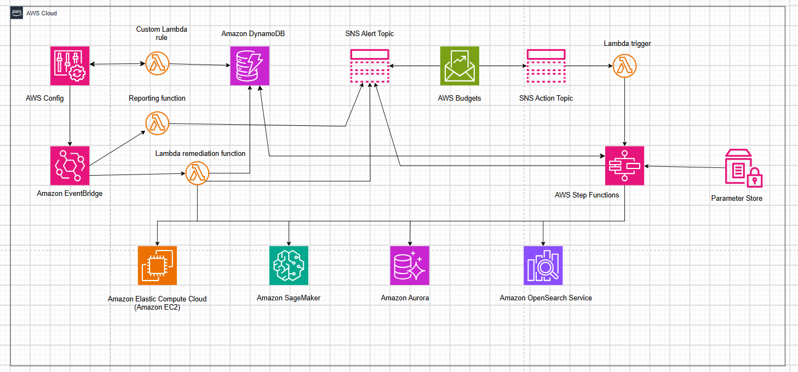
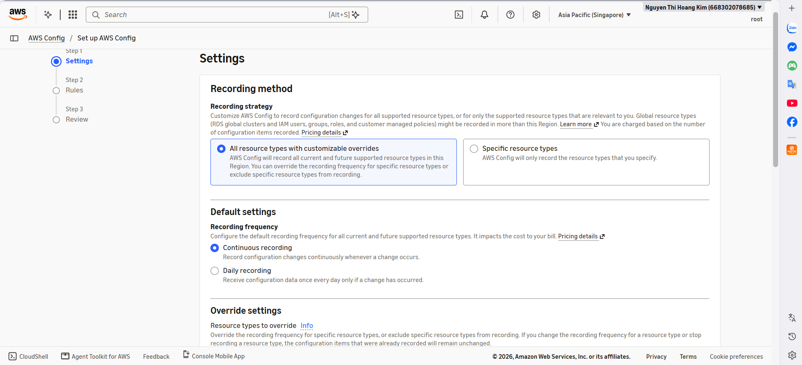
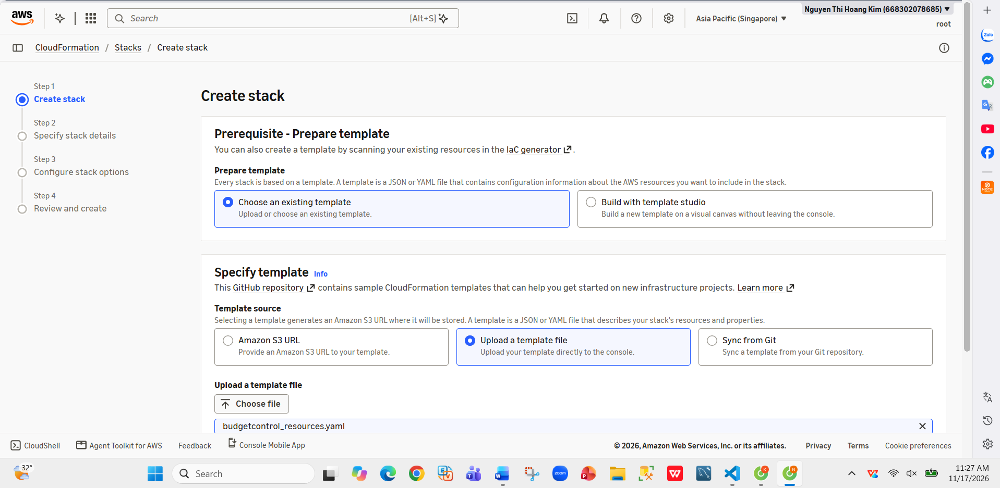
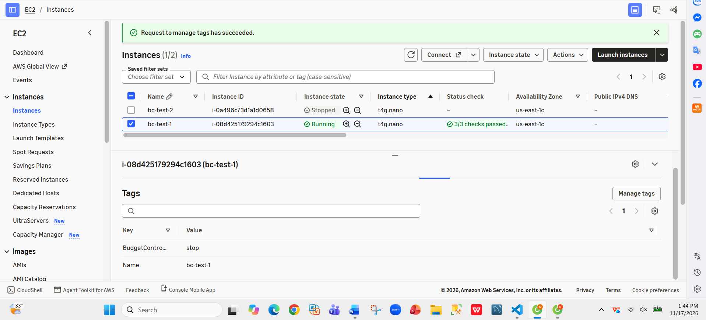
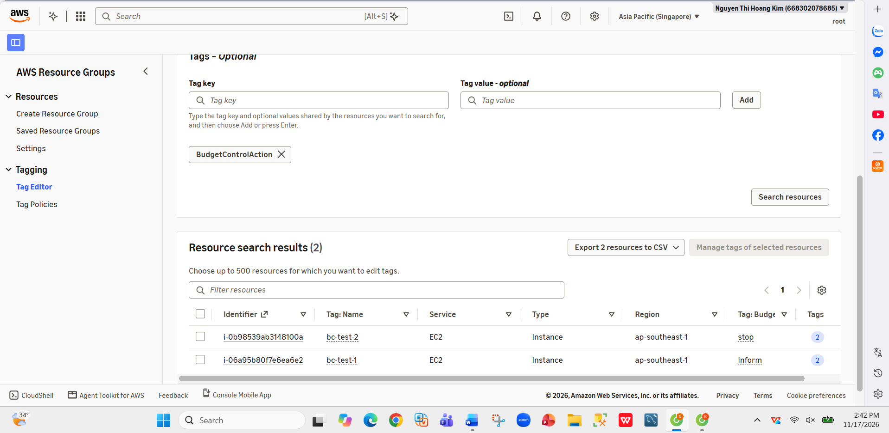

# AWS Cost Control and Optimization Strategy with Budget Controls for AWS

In a cloud environment, costs do not always increase because a single service is expensive. Sometimes, many small charges from EC2 instances, EBS volumes, snapshots, or networking components accumulate over time and cause the AWS bill to exceed expectations.

One of the challenges of managing AWS infrastructure is identifying which resources still need to run, which can be stopped, and which are no longer needed. Without timely monitoring and action, these resources may continue generating costs even when they are no longer being used.

Therefore, in addition to monitoring the budget, organizations need a mechanism that connects spending thresholds with resource management rules. **Budget Controls for AWS** is an open-source solution that combines AWS Budgets, AWS Config, and automation services to send alerts and take actions on supported resource types.

This article focuses on how the solution works, how it can be applied as part of an AWS Cost Optimization strategy, and the considerations identified through hands-on practice with Amazon EC2.

## 1. OVERVIEW OF BUDGET CONTROLS FOR AWS

### 1.1. The Cost Control Challenge

The pay-as-you-go pricing model allows users to create and scale AWS resources flexibly. However, if resources are not managed after a task is completed, they may continue to incur costs.

Common scenarios include:

- An EC2 instance remains running even though it is no longer needed.
- Resources are provisioned with more capacity than required.
- EBS volumes, snapshots, or networking resources are left unused and forgotten.
- Budgets are not monitored regularly, and increased spending is only discovered when the bill is reviewed.

**Cost Control** focuses on monitoring spending, setting alerts, and controlling actions on resources. **Cost Optimization** has a broader scope, including adjusting resource configurations, removing idle resources, and choosing appropriate usage models.

Budget Controls for AWS acts as a budget control layer that helps send alerts and automatically manage certain resources when spending reaches predefined thresholds. It is not a complete cost optimization solution and should be combined with other resource management practices.

### 1.2. AWS Services Used

Budget Controls for AWS uses several services to monitor budgets, evaluate resource tags, and perform automated actions.

| Service | Role |
|---|---|
| AWS Budgets | Tracks budgets and sends alerts when spending reaches configured thresholds. |
| AWS Config | Records configuration changes and evaluates resource tags. |
| Amazon EventBridge | Receives events and triggers processing steps. |
| AWS Lambda | Evaluates resources, adds tags, and processes notifications. |
| Amazon DynamoDB | Stores resource information and action history. |
| Amazon SNS | Sends alert emails and reports. |
| AWS Step Functions | Orchestrates the workflow that performs resource actions. |
| AWS KMS | Manages encryption keys for SNS topics. |
| AWS Systems Manager Parameter Store | Stores configuration parameters used by the workflow. |
| AWS CloudFormation | Deploys the solution's resources. |

DynamoDB is created automatically by CloudFormation to store resource information and processing results. Amazon RDS Aurora is a resource type that the solution supports managing; it is not a database that must be created during deployment.

### 1.3. Overall Architecture

AWS Budgets is responsible for monitoring spending, while AWS Config evaluates tags on supported resources. EventBridge, Lambda, DynamoDB, SNS, and Step Functions work together to record resources, perform actions, and send results.

**Architecture diagram:**

*Figure 1. Overall architecture of Budget Controls for AWS.*

The solution has two main workflows:

- **Tag management workflow:** AWS Config evaluates resource tags. If a resource does not have a valid tag, EventBridge triggers the Lambda Remediation function to add the default value `Inform`. The information is stored in DynamoDB, and a notification can also be sent through SNS.
- **Budget control workflow:** AWS Budgets sends notifications to SNS when spending reaches a configured threshold. At the action threshold, Lambda triggers Step Functions. The workflow retrieves resource information from DynamoDB, determines the action based on the tag, and records the processing result.

## 2. BUDGET CONTROL AND RESOURCE MANAGEMENT MECHANISMS

### 2.1. Budget Monitoring with the 80% and 90% Thresholds

In the default configuration described in the AWS article, the solution uses a monthly cost budget with two main thresholds:

**When spending reaches 80% of the budget:**

AWS Budgets sends a notification to the SNS Alert Topic. SNS sends an alert email to the registered address. At this threshold, the system only sends a notification; it does not stop or delete resources.

**When spending reaches 90% of the budget:**

AWS Budgets sends a notification to the SNS Action Topic. Lambda receives the notification and triggers AWS Step Functions to start the resource processing workflow based on tags.

The 80% and 90% thresholds are the solution's default settings. Users can adjust the action threshold from 90% to 100%, following AWS guidance.

**Note:** AWS Budgets does not update cost data in real time. According to AWS documentation, data is refreshed up to three times per day, typically 8–12 hours apart. As a result, actual spending may already have exceeded a threshold before the notification is delivered.

### 2.2. Classifying Actions with the BudgetControlAction Tag

The `BudgetControlAction` tag determines how a resource should be handled when the budget control workflow is triggered.

| Tag value | Meaning | Action |
|---|---|---|
| `Inform` | Notification only | Records the resource and sends information to the administrator. |
| `Stop` | Stop the resource | Stops the resource if the service supports this action. |
| `Terminate` | Delete the resource | Performs the deletion action according to the handling logic for each service. |

`Inform` is the default value. When AWS Config detects that a supported resource does not have the tag or has an invalid value, the resource may be evaluated as `NON_COMPLIANT`. Lambda Remediation is then triggered to add the default `Inform` tag.

Tag values are case-sensitive, so the exact values `Inform`, `Stop`, and `Terminate` must be used.

Several considerations apply when choosing an action:

- For EC2, `Stop` stops the instance, but any retained EBS volumes may continue to incur storage charges.
- With `Terminate`, the EC2 instance is deleted. Whether its EBS volumes are also deleted depends on the `DeleteOnTermination` setting.
- For Amazon OpenSearch Service clusters, the workflow does not support the Stop action. The `Inform` and `Stop` values only send notifications; `Terminate` performs the deletion action.

Therefore, `Stop` is suitable for test resources that can be restarted, while `Terminate` should only be used for resources that can be recreated and no longer contain data that must be retained.

### 2.3. Automated Workflow When the Budget Reaches the Action Threshold

When spending reaches the 90% threshold, the workflow asks AWS Config to reevaluate supported resources to update their compliance status and tags.

Next, Step Functions retrieves resource information from DynamoDB, determines the action based on `BudgetControlAction`, and performs the required operation. The result is stored in DynamoDB for history tracking.

After Step Functions completes successfully, EventBridge triggers the Reporting Lambda to aggregate the results and send a report through SNS.

This workflow reduces manual management tasks. However, actions only apply to supported resources that are within the Stack's management scope.

## 3. APPLYING THE SOLUTION AS PART OF AN AWS COST OPTIMIZATION STRATEGY

Budget Controls for AWS helps control resources when spending reaches a threshold. To optimize costs more effectively, users should combine the solution with the following practices.

### 3.1. Monitor and Analyze Spending

A suitable budget should be defined according to the purpose of the environment, such as learning, testing, or development. The 80% threshold provides an early warning so that administrators can review spending before the workflow reaches its action threshold.

In addition, AWS Cost Explorer can be used to analyze costs by service and time period, helping identify which components contribute most to the bill.

### 3.2. Classify Resources and Choose Appropriate Actions

Administrators should select the `BudgetControlAction` tag according to the environment and the importance of each resource:

- Development resources that need to remain available can be assigned `Inform`.
- Short-lived test EC2 instances that can be restarted can be considered for `Stop`.
- Temporary resources that can be recreated and do not contain data that must be retained can be considered for `Terminate`.

The `Terminate` action should not be applied indiscriminately because it may cause data loss or application disruption.

In addition to the action-control tag, users should apply classification tags for project, environment, and owner to support cost tracking and allocation. `BudgetControlAction` does not replace tags used for cost management.

### 3.3. Right-Sizing and Managing Idle Resources

Right-sizing is the process of adjusting resource configurations to match actual usage requirements and avoiding the allocation of more capacity than necessary.

For EC2, users can monitor CPU, memory, and network metrics to evaluate which instance type is appropriate. AWS Cost Explorer provides Rightsizing Recommendations to identify certain EC2 instances that may be over-provisioned. AWS Compute Optimizer also provides configuration recommendations based on utilization data.

For development and testing environments, users can schedule resources to start and stop according to working hours when the workload allows it. For workloads with changing demand, Auto Scaling can adjust capacity based on load.

Savings Plans or Reserved Instances may also be considered for stable workloads. Spot Instances are more suitable for tasks that can tolerate interruptions. These are additional Cost Optimization practices, not automatic features of Budget Controls for AWS.

### 3.4. Control Storage and Networking Costs

Budget Controls for AWS does not manage every AWS resource. Therefore, components outside its supported scope may continue to incur costs even after an EC2 instance is stopped or deleted.

Users should review EBS volumes, snapshots, S3 buckets, NAT Gateways, and Elastic IP addresses. For infrequently accessed data, suitable S3 Lifecycle policies and storage classes can be considered. Volumes or snapshots that are no longer needed should also be reviewed and removed.

Stopping an EC2 instance does not mean that all related costs have been eliminated.

### 3.5. Evaluate Suitability for Real-World Environments

Budget Controls for AWS is suitable for environments with many test resources that need a mechanism to control them when spending reaches a threshold.

In a learning environment, EC2 instances can be tagged with `Stop` if they can be restarted when needed. For a system serving users, `Inform` may be more appropriate so that the operations team can review the situation before taking action and avoid service interruptions.

Another limitation is that the solution does not manage all AWS resources. Even when an EC2 instance is stopped, related EBS volumes, snapshots, or networking components may continue to incur costs.

Therefore, Budget Controls for AWS should be considered a tool that helps enforce resource control policies. The effectiveness of Cost Optimization still depends on selecting appropriate actions, adjusting configurations, and regularly monitoring resource utilization.

## 4. HANDS-ON DEPLOYMENT AND TESTING WITH AMAZON EC2

The hands-on exercise was performed in the **Asia Pacific (Singapore) – `ap-southeast-1`** Region, using EC2 as the test resource. DynamoDB, Lambda, EventBridge, and Step Functions were deployed through a CloudFormation template; their roles were analyzed based on the architecture and source code. Aurora was not created during the exercise.

### 4.1. Enable AWS Config

Open AWS Config in the Singapore Region and use **1-click setup** to configure resource configuration recording.

After setup is complete, check the status of the Config Recorder and Delivery Channel before deploying the CloudFormation stack.

*Figure 2. Set up AWS Config and verify its operating status in the Singapore Region.*

### 4.2. Deploy the Solution Using AWS CloudFormation

Download the Budget Controls for AWS repository from AWS Labs and use the `budgetcontrol_resources.yaml` file.

Open the CloudFormation Console, select **Create stack → With new resources (standard)**, upload the template, and provide the required information:

- Stack name: `BudgetControl`.
- BudgetAmount: the monthly budget amount in USD.
- Notification email: the email address that must confirm the SNS subscription.

The email parameter name must match the version of the YAML file being used. In the referenced template, the parameter is `NotificationEmail`; the repository README may display a different name.

Next, review the requested IAM permissions, create the Stack, and wait for its status to become `CREATE_COMPLETE`. Then open the email and confirm the SNS subscription.

*Figure 3. Deploy Budget Controls for AWS using CloudFormation in the Singapore Region.*

### 4.3. Create EC2 Instances and Check the Default Tag

Create two EC2 instances in the same Region as the CloudFormation Stack:

- `bc-test-1`.
- `bc-test-2`.

After AWS Config records the configuration changes, the Custom Config Rule evaluates the `BudgetControlAction` tag on supported resources. If the tag does not exist or its value is invalid, Lambda Remediation may add the default value `Inform`.

Users can check the tag in the EC2 Console or AWS Resource Groups Tag Editor. Allow time for AWS Config to record and evaluate the resource before concluding that remediation has failed.

*Figure 4. Check the `BudgetControlAction` tag on EC2.*

### 4.4. Change the Tag Using the EC2 Console or Tag Editor

Users can update the tag in either of the following ways:

- **EC2 Console:** Select an instance, open the Tags tab, choose Manage tags, and edit the `BudgetControlAction` value.
- **AWS Resource Groups Tag Editor:** Select the Region, search for the tag, and update the selected resources.

Example:

| EC2 instance | Tag value |
|---|---|
| `bc-test-1` | `Inform` |
| `bc-test-2` | `Stop` |

After updating the tag, check its value again to ensure that the change has been applied.

**Note:** Changing the tag to `Stop` does not stop the EC2 instance immediately. The tag only determines the action to be taken when the budget control workflow is triggered. Verifying that the `Stop` tag is present does not mean that the entire resource-stopping workflow has been successfully tested at the budget threshold.

*Figure 5. Manage tags using AWS Resource Groups Tag Editor.*

## 5. COSTS AND LIMITATIONS TO CONSIDER

### 5.1. Solution Operating Costs

Budget Controls for AWS itself uses services that may incur charges, including AWS Config, AWS KMS, Lambda, Step Functions, DynamoDB, SNS, and CloudWatch Logs.

AWS Config can contribute significantly to variable costs because of Configuration Items recorded and Config Rule evaluations. Actual costs depend on the Region, the number of resources, and how frequently their configurations change.

### 5.2. Scope and Limitations

Several important limitations should be considered:

1. **One AWS account:** Each Stack manages only one account.
2. **One AWS Region:** The solution operates in the Region where the Stack is deployed.
3. **Limited resource types:** The AWS article states that the solution supports EC2, RDS Aurora, SageMaker Notebook Instances and Domains, and OpenSearch clusters. It does not manage every AWS service.
4. **Resources outside the scope:** Storage, networking, and unsupported services may continue to incur costs.
5. **Service-dependent actions:** Not every resource type supports all three actions: `Inform`, `Stop`, and `Terminate`.
6. **Budget data latency:** AWS Budgets does not update cost data in real time, so spending may continue to increase after a notification is sent.

### 5.3. Triggering and Cleanup Limitations

According to the original AWS article, after the workflow performs an action, a resource may be restarted or recreated. However, the default workflow is triggered at most once per month unless the budget is adjusted to a higher level. When the budget moves into the next month, resources that were stopped or deleted are not automatically restored.

After completing the exercise, delete the CloudFormation Stack if it is no longer needed and check for remaining resources:

- The `BudgetControlAction` tag may remain on resources.
- CloudWatch Log Groups and Aurora final snapshots may need to be checked separately.
- EC2 instances, EBS volumes, snapshots, and Elastic IP addresses should be reviewed to avoid continued charges.
- The AWS Config Recorder, Delivery Channel, and S3 bucket should be checked before deletion because other services may still be using them.

After cleanup, check AWS Billing and Cost Management to monitor any remaining charges.

## 6. CONCLUSION

Budget Controls for AWS is a solution that helps control costs by combining AWS Budgets, AWS Config, and automation services. Through its two default budget thresholds of 80% and 90%, users can receive alerts and trigger workflows to manage supported resources.

The `BudgetControlAction` tag allows users to select the `Inform`, `Stop`, or `Terminate` action. AWS Config evaluates the tag, Lambda helps add the default tag, DynamoDB stores resource information and action history, and Step Functions orchestrates the automated workflow.

The hands-on exercise with Amazon EC2 demonstrates how the solution can reduce manual management tasks and help limit costs from resources that are no longer needed. However, the solution does not manage every AWS service, budget updates are delayed, and the solution itself also incurs operating costs.

Therefore, Budget Controls for AWS should be viewed as one layer of protection within a broader Cost Optimization strategy, rather than a complete cost optimization solution. Sustainable cost management requires combining budget monitoring with right-sizing, idle resource management, and storage and networking cost controls.

## REFERENCES

- AWS Cloud Financial Management Blog – *Introducing Budget Controls for AWS: Automatically Manage Your Cloud Costs* (September 5, 2025):  
  https://aws.amazon.com/vi/blogs/aws-cloud-financial-management/introducing-budget-controls-for-aws-automatically-manage-your-cloud-costs/
- GitHub – AWS Labs: *Budget Controls for AWS*: https://github.com/awslabs/budget-controls-for-aws
- GitHub – CloudFormation template `budgetcontrol_resources.yaml`: https://github.com/awslabs/budget-controls-for-aws/blob/main/budgetcontrol_resources.yaml
- AWS Budgets – Managing your costs with AWS Budgets: https://docs.aws.amazon.com/cost-management/latest/userguide/budgets-managing-costs.html
- AWS Config Developer Guide: https://docs.aws.amazon.com/config/latest/developerguide/WhatIsConfig.html
- AWS Config Pricing: https://aws.amazon.com/config/pricing/
- AWS Well-Architected Framework – Cost Optimization Pillar: https://docs.aws.amazon.com/wellarchitected/latest/cost-optimization-pillar/
- AWS Cost Explorer – Rightsizing recommendations: https://docs.aws.amazon.com/cost-management/latest/userguide/ce-rightsizing.html
- AWS Compute Optimizer: https://docs.aws.amazon.com/compute-optimizer/latest/ug/what-is-compute-optimizer.html
- AWS Pricing Calculator: https://calculator.aws/