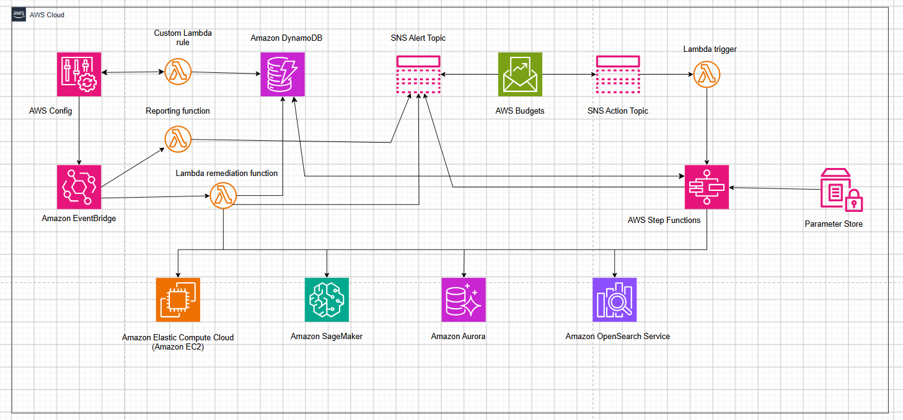
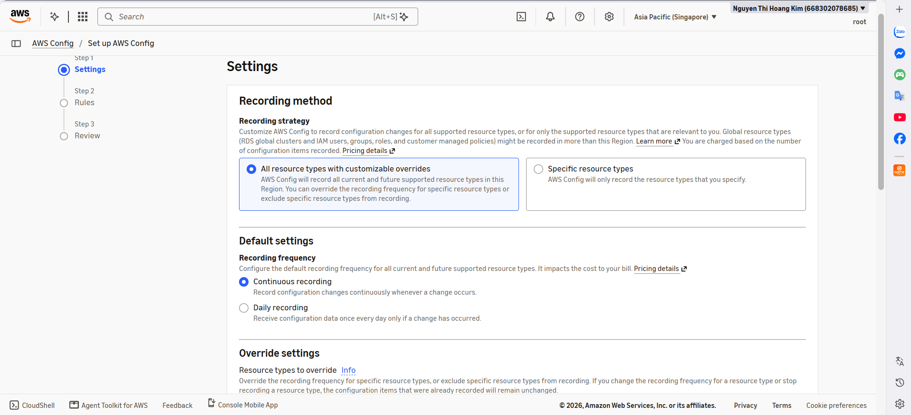
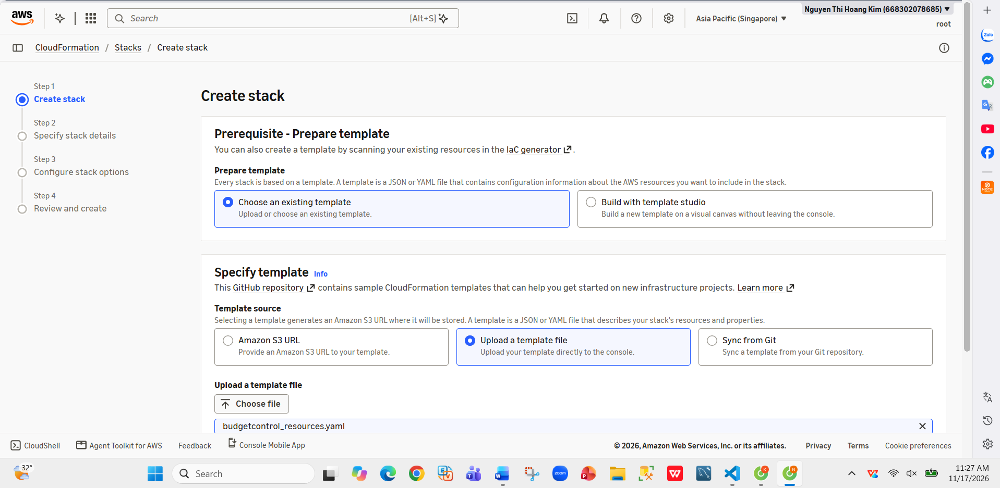
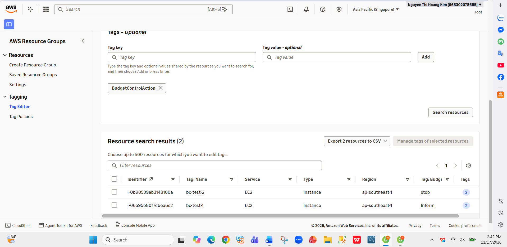

# CHIẾN LƯỢC KIỂM SOÁT VÀ TỐI ƯU CHI PHÍ AWS VỚI BUDGET CONTROLS FOR AWS

Trong môi trường Cloud, chi phí không phải lúc nào cũng tăng do một dịch vụ có giá cao. Đôi khi, nhiều khoản chi nhỏ từ EC2 Instances, EBS Volumes, Snapshots hoặc các thành phần mạng cộng dồn trong thời gian dài mới là nguyên nhân khiến hóa đơn AWS vượt dự kiến.

Một trong những khó khăn khi quản lý hạ tầng AWS là xác định tài nguyên nào vẫn cần hoạt động, tài nguyên nào có thể dừng và tài nguyên nào không còn cần thiết. Nếu không theo dõi và xử lý kịp thời, những tài nguyên này có thể tiếp tục phát sinh chi phí dù không còn được sử dụng.

Vì vậy, bên cạnh việc theo dõi ngân sách, cần có cơ chế liên kết mức chi tiêu với quy tắc quản lý tài nguyên. **Budget Controls for AWS** là giải pháp mã nguồn mở kết hợp AWS Budgets, AWS Config và các dịch vụ tự động hóa để cảnh báo và thực hiện hành động trên một số loại tài nguyên được hỗ trợ.

Bài viết tập trung phân tích cách giải pháp hoạt động, khả năng áp dụng vào chiến lược Cost Optimization và những điểm cần lưu ý qua quá trình thực hành trên Amazon EC2.

## 1. TỔNG QUAN VỀ BUDGET CONTROLS FOR AWS

### 1.1. Bài toán kiểm soát chi phí

Mô hình thanh toán theo mức sử dụng giúp người dùng linh hoạt tạo và mở rộng tài nguyên AWS. Tuy nhiên, nếu không quản lý sau khi công việc hoàn tất, tài nguyên vẫn có thể phát sinh chi phí.

Một số tình huống thường gặp:
- EC2 Instance vẫn hoạt động dù không còn nhu cầu sử dụng.
- Cấu hình tài nguyên lớn hơn mức cần thiết.
- EBS Volumes, Snapshots hoặc tài nguyên mạng bị bỏ quên.
- Không theo dõi ngân sách thường xuyên và chỉ phát hiện chi phí tăng khi kiểm tra hóa đơn.

**Cost Control** tập trung vào theo dõi chi tiêu, thiết lập cảnh báo và kiểm soát hành động trên tài nguyên. Trong khi đó, **Cost Optimization** có phạm vi rộng hơn, bao gồm điều chỉnh cấu hình, loại bỏ tài nguyên nhàn rỗi và lựa chọn mô hình sử dụng phù hợp.

Budget Controls for AWS đóng vai trò như một lớp kiểm soát ngân sách, hỗ trợ cảnh báo và tự động xử lý một số tài nguyên khi chi tiêu đạt ngưỡng. Đây không phải giải pháp tối ưu chi phí toàn diện mà cần kết hợp với các biện pháp quản lý khác.

### 1.2. Các dịch vụ AWS được sử dụng

Budget Controls for AWS sử dụng nhiều dịch vụ để theo dõi ngân sách, kiểm tra tag và thực hiện hành động tự động.

| Dịch vụ | Vai trò |
|---|---|
| AWS Budgets | Theo dõi ngân sách và gửi cảnh báo theo ngưỡng. |
| AWS Config | Ghi nhận thay đổi cấu hình và đánh giá tag tài nguyên. |
| Amazon EventBridge | Tiếp nhận sự kiện và kích hoạt các bước xử lý. |
| AWS Lambda | Kiểm tra, bổ sung tag và xử lý thông báo. |
| Amazon DynamoDB | Lưu thông tin tài nguyên và lịch sử hành động. |
| Amazon SNS | Gửi email cảnh báo và báo cáo. |
| AWS Step Functions | Điều phối quy trình thực hiện hành động. |
| AWS KMS | Quản lý khóa mã hóa cho SNS Topics. |
| AWS Systems Manager Parameter Store | Lưu tham số cấu hình phục vụ workflow. |
| AWS CloudFormation | Triển khai các tài nguyên của giải pháp. |

DynamoDB được CloudFormation tạo tự động để lưu thông tin tài nguyên và kết quả xử lý. Amazon RDS Aurora là một loại tài nguyên được giải pháp hỗ trợ quản lý, không phải cơ sở dữ liệu bắt buộc phải tạo khi triển khai.

### 1.3. Kiến trúc tổng thể

AWS Budgets chịu trách nhiệm theo dõi chi tiêu, trong khi AWS Config đánh giá tag trên các tài nguyên thuộc phạm vi hỗ trợ. EventBridge, Lambda, DynamoDB, SNS và Step Functions phối hợp để ghi nhận tài nguyên, thực hiện hành động và gửi kết quả.

**Sơ đồ kiến trúc:**

*Hình 1. Kiến trúc tổng thể của Budget Controls for AWS.*

Giải pháp có hai luồng hoạt động chính:

- **Luồng quản lý tag:** AWS Config đánh giá tag tài nguyên. Nếu tài nguyên chưa có tag hợp lệ, EventBridge kích hoạt Lambda Remediation để bổ sung giá trị mặc định `Inform`. Thông tin được lưu trong DynamoDB và có thể gửi thông báo qua SNS.
- **Luồng kiểm soát ngân sách:** AWS Budgets gửi thông báo đến SNS theo ngưỡng. Khi đạt ngưỡng hành động, Lambda kích hoạt Step Functions. Workflow đọc thông tin tài nguyên từ DynamoDB, xác định hành động theo tag và lưu lại kết quả xử lý.

## 2. CƠ CHẾ KIỂM SOÁT NGÂN SÁCH VÀ QUẢN LÝ TÀI NGUYÊN

### 2.1. Theo dõi ngân sách với hai ngưỡng 80% và 90%

Trong cấu hình mặc định được mô tả trong bài AWS, giải pháp sử dụng ngân sách chi phí hàng tháng với hai ngưỡng chính:

**Khi chi tiêu đạt 80% ngân sách:**

AWS Budgets gửi thông báo đến SNS Alert Topic. SNS gửi email cảnh báo đến địa chỉ đã đăng ký. Ở ngưỡng này, hệ thống chỉ thông báo và chưa thực hiện hành động dừng hoặc xóa tài nguyên.

**Khi chi tiêu đạt 90% ngân sách:**

AWS Budgets gửi thông báo đến SNS Action Topic. Lambda tiếp nhận thông báo và kích hoạt AWS Step Functions để bắt đầu quy trình xử lý tài nguyên theo tag.

Ngưỡng 80% và 90% là cấu hình mặc định của giải pháp. Người dùng có thể điều chỉnh ngưỡng kích hoạt hành động từ 90% lên 100% theo hướng dẫn của AWS.

**Lưu ý:** AWS Budgets không cập nhật chi phí theo thời gian thực. Theo tài liệu AWS, dữ liệu được cập nhật tối đa ba lần mỗi ngày và thường cách lần cập nhật trước khoảng 8–12 giờ. Vì vậy, chi phí thực tế có thể đã vượt ngưỡng trước khi thông báo được gửi.

### 2.2. Phân loại hành động bằng tag BudgetControlAction

Tag `BudgetControlAction` xác định cách xử lý tài nguyên khi workflow kiểm soát ngân sách được kích hoạt.

| Giá trị tag | Ý nghĩa | Hành động |
|---|---|---|
| `Inform` | Chỉ thông báo | Ghi nhận tài nguyên và gửi thông tin cho người quản lý. |
| `Stop` | Dừng tài nguyên | Dừng tài nguyên nếu dịch vụ hỗ trợ. |
| `Terminate` | Xóa tài nguyên | Thực hiện hành động xóa theo cách xử lý của từng dịch vụ. |

`Inform` là giá trị mặc định. Khi AWS Config phát hiện tài nguyên được hỗ trợ chưa có tag hoặc có giá trị không hợp lệ, tài nguyên có thể được đánh giá là `NON_COMPLIANT`. Lambda Remediation được kích hoạt để bổ sung tag mặc định `Inform`.

Các giá trị tag phân biệt chữ hoa và chữ thường, vì vậy cần nhập đúng `Inform`, `Stop` hoặc `Terminate`.

Một số lưu ý khi lựa chọn hành động:

- Với EC2, `Stop` dừng Instance nhưng EBS Volumes được giữ lại vẫn có thể phát sinh chi phí lưu trữ.
- Với `Terminate`, EC2 Instance bị xóa. Việc EBS Volume có bị xóa theo hay không phụ thuộc cấu hình `DeleteOnTermination`.
- Với Amazon OpenSearch Service clusters, workflow không hỗ trợ hành động Stop. Giá trị `Inform` và `Stop` chỉ gửi thông báo; `Terminate` mới thực hiện hành động xóa.

Do đó, `Stop` phù hợp với tài nguyên thử nghiệm có thể khởi động lại, còn `Terminate` chỉ nên áp dụng cho tài nguyên có thể tạo lại và không còn dữ liệu cần giữ.

### 2.3. Quy trình tự động khi ngân sách đạt ngưỡng hành động

Khi ngân sách đạt ngưỡng 90%, workflow yêu cầu AWS Config đánh giá lại các tài nguyên được hỗ trợ để cập nhật trạng thái và tag.

Tiếp theo, Step Functions đọc thông tin tài nguyên từ DynamoDB, xác định hành động theo `BudgetControlAction` và thực hiện xử lý. Kết quả được lưu trong DynamoDB để theo dõi lịch sử.

Sau khi Step Functions hoàn tất thành công, EventBridge kích hoạt Reporting Lambda để tổng hợp kết quả và gửi báo cáo qua SNS.

Quy trình này giúp giảm thao tác quản lý thủ công. Tuy nhiên, hành động chỉ áp dụng cho các tài nguyên được hỗ trợ và thuộc phạm vi quản lý của Stack.

## 3. ÁP DỤNG VÀO CHIẾN LƯỢC TỐI ƯU CHI PHÍ AWS

Budget Controls for AWS giúp kiểm soát tài nguyên khi ngân sách đạt ngưỡng. Để tối ưu chi phí hiệu quả hơn, người dùng nên kết hợp giải pháp với các biện pháp sau.

### 3.1. Theo dõi và phân tích chi tiêu

Nên xác định ngân sách phù hợp với mục đích sử dụng như học tập, thử nghiệm hoặc phát triển. Ngưỡng 80% giúp người quản lý nhận cảnh báo sớm để kiểm tra mức chi tiêu trước khi workflow đạt ngưỡng hành động.

Bên cạnh đó, AWS Cost Explorer có thể được sử dụng để phân tích chi phí theo dịch vụ và khoảng thời gian, giúp xác định những thành phần đang đóng góp nhiều vào hóa đơn.

### 3.2. Phân loại tài nguyên và lựa chọn hành động

Người quản lý nên lựa chọn tag `BudgetControlAction` theo môi trường và mức độ quan trọng của tài nguyên:

- Tài nguyên phát triển cần tiếp tục hoạt động có thể đặt `Inform`.
- EC2 thử nghiệm ngắn hạn, có thể khởi động lại, có thể cân nhắc `Stop`.
- Tài nguyên tạm thời, có thể tạo lại và không chứa dữ liệu cần lưu giữ, mới nên cân nhắc `Terminate`.

Không nên sử dụng `Terminate` hàng loạt vì hành động này có thể gây mất dữ liệu hoặc làm gián đoạn ứng dụng.

Ngoài tag điều khiển hành động, người dùng nên sử dụng thêm tag phân loại dự án, môi trường và chủ sở hữu để hỗ trợ theo dõi, phân bổ chi phí. `BudgetControlAction` không thay thế các tag phục vụ quản lý chi phí.

### 3.3. Right-Sizing và quản lý tài nguyên nhàn rỗi

Right-Sizing là quá trình điều chỉnh cấu hình tài nguyên phù hợp với nhu cầu sử dụng thực tế, tránh cấp phát công suất lớn hơn mức cần thiết.

Đối với EC2, người dùng có thể theo dõi CPU, bộ nhớ và Network để đánh giá loại Instance phù hợp. AWS Cost Explorer cung cấp Rightsizing Recommendations để nhận diện một số EC2 Instances có khả năng đang được cấp phát vượt nhu cầu. AWS Compute Optimizer cũng hỗ trợ đề xuất cấu hình dựa trên dữ liệu sử dụng.

Với môi trường phát triển và thử nghiệm, có thể thiết lập lịch bật/tắt tài nguyên theo thời gian làm việc nếu workload cho phép. Với workload có nhu cầu thay đổi, Auto Scaling giúp điều chỉnh công suất theo tải.

Ngoài ra, Savings Plans hoặc Reserved Instances có thể được xem xét cho workload ổn định. Spot Instances phù hợp hơn với tác vụ có khả năng chịu gián đoạn. Đây là các biện pháp Cost Optimization bổ sung, không phải chức năng tự động của Budget Controls for AWS.

### 3.4. Kiểm soát chi phí lưu trữ và mạng

Budget Controls for AWS không quản lý tất cả tài nguyên AWS. Vì vậy, các thành phần ngoài phạm vi hỗ trợ vẫn có thể tiếp tục phát sinh chi phí sau khi EC2 bị dừng hoặc xóa.

Người dùng cần rà soát EBS Volumes, Snapshots, S3 Buckets, NAT Gateway và Elastic IP. Với dữ liệu ít được truy cập, có thể xem xét S3 Lifecycle và Storage Class phù hợp. Những Volume hoặc Snapshot không còn cần thiết cũng nên được kiểm tra và dọn dẹp.

Việc dừng EC2 không đồng nghĩa toàn bộ chi phí liên quan đã được loại bỏ.

### 3.5. Đánh giá khả năng áp dụng trong môi trường thực tế

Budget Controls for AWS phù hợp với môi trường có nhiều tài nguyên thử nghiệm và cần cơ chế kiểm soát khi chi tiêu đạt ngưỡng.

Đối với môi trường học tập, EC2 có thể được gắn tag `Stop` nếu có thể khởi động lại khi cần. Đối với hệ thống đang phục vụ người dùng, `Inform` có thể phù hợp hơn để đội vận hành kiểm tra trước khi can thiệp, tránh dừng tài nguyên gây gián đoạn dịch vụ.

Một giới hạn khác là giải pháp không quản lý toàn bộ tài nguyên AWS. Ngay cả khi EC2 đã dừng, EBS Volumes, Snapshots hoặc các thành phần mạng liên quan vẫn có thể tạo chi phí.

Vì vậy, Budget Controls for AWS nên được xem là công cụ hỗ trợ thực thi chính sách kiểm soát tài nguyên. Hiệu quả Cost Optimization còn phụ thuộc vào việc lựa chọn hành động, điều chỉnh cấu hình và theo dõi mức sử dụng thường xuyên.

## 4. THỰC HÀNH TRIỂN KHAI VÀ KIỂM TRA TRÊN AMAZON EC2

Phần thực hành được thực hiện tại Region **Asia Pacific (Singapore) – `ap-southeast-1`**, sử dụng EC2 làm tài nguyên thử nghiệm. Các dịch vụ DynamoDB, Lambda, EventBridge và Step Functions được CloudFormation triển khai theo Template; vai trò của chúng được phân tích dựa trên kiến trúc và mã nguồn. Aurora không được tạo trong quá trình thực hành.

### 4.1. Bật AWS Config

Truy cập AWS Config tại Region Singapore và sử dụng **1-click setup** để thiết lập ghi nhận cấu hình tài nguyên.

Sau khi hoàn tất, kiểm tra trạng thái Config Recorder và Delivery Channel trước khi triển khai CloudFormation.

*Hình 2. Thiết lập và kiểm tra trạng thái hoạt động của AWS Config tại Region Singapore.*

### 4.2. Triển khai bằng AWS CloudFormation

Tải repository Budget Controls for AWS từ AWS Labs và sử dụng file `budgetcontrol_resources.yaml`.

Truy cập CloudFormation Console, chọn **Create stack → With new resources (standard)**, tải lên Template và nhập các thông tin cần thiết:

- Stack name: `BudgetControl`.
- BudgetAmount: mức ngân sách hàng tháng tính bằng USD.
- Email nhận thông báo: địa chỉ email cần xác nhận SNS Subscription.

Tên tham số email cần căn cứ vào đúng phiên bản file YAML đã tải lên. Trong Template được tham chiếu, tham số là `NotificationEmail`; README của repository có thể hiển thị tên khác.

Tiếp theo, kiểm tra quyền IAM được yêu cầu, tạo Stack và chờ trạng thái `CREATE_COMPLETE`. Sau đó, mở email và xác nhận SNS Subscription.

*Hình 3. Triển khai Budget Controls for AWS bằng CloudFormation tại Region Singapore.*

### 4.3. Tạo EC2 và kiểm tra tag mặc định

Tạo hai EC2 Instances tại cùng Region với CloudFormation Stack:

- `bc-test-1`.
- `bc-test-2`.

Sau khi AWS Config ghi nhận thay đổi cấu hình, Custom Config Rule đánh giá tag `BudgetControlAction` trên tài nguyên được hỗ trợ. Nếu tag chưa tồn tại hoặc không hợp lệ, Lambda Remediation có thể bổ sung giá trị mặc định `Inform`.

Người dùng kiểm tra tag trong EC2 Console hoặc AWS Resource Groups Tag Editor. Cần chờ AWS Config hoàn tất ghi nhận và đánh giá trước khi kết luận quá trình remediation chưa hoạt động.

*Hình 4. Kiểm tra tag `BudgetControlAction` trên EC2.*

### 4.4. Thay đổi tag bằng EC2 Console hoặc Tag Editor

Người dùng có thể cập nhật tag bằng một trong hai cách:

- **EC2 Console:** Chọn Instance, mở tab Tags, chọn Manage tags và sửa giá trị `BudgetControlAction`.
- **AWS Resource Groups Tag Editor:** Chọn Region, tìm kiếm tag và cập nhật các tài nguyên được chọn.

Ví dụ:

| EC2 Instance | Giá trị tag |
|---|---|
| `bc-test-1` | `Inform` |
| `bc-test-2` | `Stop` |

Sau khi cập nhật, kiểm tra lại giá trị tag để bảo đảm thay đổi đã được áp dụng.

**Lưu ý:** Đổi tag sang `Stop` không làm EC2 dừng ngay lập tức. Tag chỉ xác định hành động khi workflow kiểm soát ngân sách được kích hoạt. Kiểm tra được tag `Stop` không đồng nghĩa đã kiểm thử thành công toàn bộ quy trình dừng tài nguyên ở ngưỡng ngân sách.

*Hình 5. Quản lý tag bằng AWS Resource Groups Tag Editor.*

## 5. CHI PHÍ VÀ NHỮNG GIỚI HẠN CẦN LƯU Ý

### 5.1. Chi phí vận hành giải pháp

Bản thân Budget Controls for AWS cũng sử dụng các dịch vụ có thể phát sinh chi phí, gồm AWS Config, AWS KMS, Lambda, Step Functions, DynamoDB, SNS và CloudWatch Logs.

AWS Config có thể đóng góp đáng kể vào chi phí biến đổi do ghi nhận Configuration Items và đánh giá Config Rules. Chi phí thực tế phụ thuộc Region, số lượng tài nguyên và tần suất thay đổi cấu hình.

### 5.2. Phạm vi và giới hạn

Một số giới hạn quan trọng cần lưu ý:

1. **Một AWS Account:** Mỗi Stack chỉ quản lý một tài khoản.
2. **Một AWS Region:** Giải pháp hoạt động trong Region nơi Stack được triển khai.
3. **Loại tài nguyên có giới hạn:** Bài AWS công bố hỗ trợ EC2, RDS Aurora, SageMaker Notebook Instances và Domains, cùng OpenSearch clusters. Không phải mọi dịch vụ AWS đều được quản lý.
4. **Tài nguyên ngoài phạm vi:** Storage, networking và các dịch vụ không được hỗ trợ vẫn có thể phát sinh chi phí.
5. **Hành động phụ thuộc dịch vụ:** Không phải mọi loại tài nguyên đều hỗ trợ cả ba hành động `Inform`, `Stop` và `Terminate`.
6. **Độ trễ ngân sách:** AWS Budgets không cập nhật chi phí theo thời gian thực, vì vậy chi phí có thể tiếp tục tăng sau khi thông báo được gửi.

### 5.3. Giới hạn kích hoạt và dọn dẹp

Theo bài AWS gốc, sau khi workflow đã thực hiện hành động, tài nguyên có thể được khởi động lại hoặc tạo lại. Tuy nhiên, workflow mặc định chỉ kích hoạt tối đa một lần trong tháng, trừ khi ngân sách được điều chỉnh lên mức cao hơn. Khi ngân sách chuyển sang tháng tiếp theo, trạng thái tài nguyên đã dừng hoặc xóa không tự động được khôi phục.

Sau khi hoàn thành thử nghiệm, nên xóa CloudFormation Stack không còn sử dụng và kiểm tra các tài nguyên còn tồn tại:

- Tag `BudgetControlAction` có thể vẫn còn trên tài nguyên.
- CloudWatch Log Groups và Aurora Final Snapshots có thể cần được kiểm tra riêng.
- EC2 Instances, EBS Volumes, Snapshots và Elastic IP cần được rà soát để tránh tiếp tục phát sinh chi phí.
- AWS Config Recorder, Delivery Channel và S3 Bucket cần được kiểm tra trước khi xóa vì có thể đang được dịch vụ khác sử dụng.

Sau khi dọn dẹp, kiểm tra AWS Billing and Cost Management để theo dõi các khoản chi phí còn phát sinh.

## 6. KẾT LUẬN

Budget Controls for AWS là giải pháp hỗ trợ kiểm soát chi phí bằng cách kết hợp AWS Budgets, AWS Config và các dịch vụ tự động hóa. Thông qua hai ngưỡng ngân sách mặc định 80% và 90%, người dùng có thể nhận cảnh báo và kích hoạt workflow để xử lý những tài nguyên được hỗ trợ.

Tag `BudgetControlAction` cho phép lựa chọn hành động `Inform`, `Stop` hoặc `Terminate`. AWS Config đánh giá tag, Lambda hỗ trợ bổ sung tag mặc định, DynamoDB lưu thông tin và lịch sử xử lý, còn Step Functions điều phối quy trình tự động.

Qua quá trình tìm hiểu và thực hành trên Amazon EC2, có thể thấy giải pháp giúp giảm thao tác quản lý thủ công và hạn chế chi phí từ tài nguyên không còn cần thiết. Tuy nhiên, giải pháp không quản lý mọi dịch vụ AWS, có độ trễ cập nhật ngân sách và bản thân nó cũng phát sinh chi phí vận hành.

Vì vậy, Budget Controls for AWS nên được xem là một lớp bảo vệ trong chiến lược Cost Optimization, không phải giải pháp tối ưu chi phí toàn diện. Để quản lý chi phí bền vững, người dùng cần kết hợp theo dõi ngân sách với Right-Sizing, quản lý tài nguyên nhàn rỗi và kiểm soát chi phí lưu trữ, mạng.

## TÀI LIỆU THAM KHẢO

- AWS Cloud Financial Management Blog – *Introducing Budget Controls for AWS: Automatically Manage Your Cloud Costs* (05/09/2025):  
https://aws.amazon.com/vi/blogs/aws-cloud-financial-management/introducing-budget-controls-for-aws-automatically-manage-your-cloud-costs/
- GitHub – AWS Labs: *Budget Controls for AWS*: https://github.com/awslabs/budget-controls-for-aws
- GitHub – CloudFormation Template `budgetcontrol_resources.yaml`: https://github.com/awslabs/budget-controls-for-aws/blob/main/budgetcontrol_resources.yaml
- AWS Budgets – Managing your costs with AWS Budgets: https://docs.aws.amazon.com/cost-management/latest/userguide/budgets-managing-costs.html
- AWS Config Developer Guide: https://docs.aws.amazon.com/config/latest/developerguide/WhatIsConfig.html
- AWS Config Pricing: https://aws.amazon.com/config/pricing/
- AWS Well-Architected Framework – Cost Optimization Pillar: https://docs.aws.amazon.com/wellarchitected/latest/cost-optimization-pillar/
- AWS Cost Explorer – Rightsizing recommendations: https://docs.aws.amazon.com/cost-management/latest/userguide/ce-rightsizing.html
- AWS Compute Optimizer: https://docs.aws.amazon.com/compute-optimizer/latest/ug/what-is-compute-optimizer.html
- AWS Pricing Calculator: https://calculator.aws/